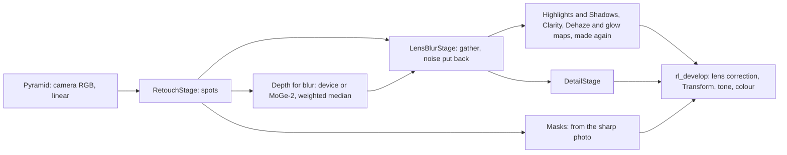

# Lens blur: design (OTH-03, #138)

A lens blur gives a photo the shallow depth of field of a wide aperture after it was taken: from the photo and a map of its depth, what lies outside the chosen focus is blurred as a lens would blur it, in linear light, with the aperture's shape, lights that keep their energy and the photo's own grain. It does what Lightroom's Lens Blur does, and more on phone photos and in the blur itself.

This document is the design built on the research in [the OTH-03 note](../research/notes/OTH-03-lens-blur.md): Lightroom's feature and the competitors (§1–§2), the methods and models (§3–§4), the patents (§6), and the measurements against the exact-truth benchmark (§8–§11). Nothing in the app has changed. The panel's wireframes are the canvas `lens-blur-wireframes.canvas.tsx`, with the questions for the owner.

Proposed tracker rows: OTH-05 to OTH-12 ([below](#proposed-rows)); OTH-03 becomes the research and design row.

**Status (2026-10-14):** parked. The owner deferred lens blur the day it was written: it needs more research and calibration, and isn't a priority now. OTH-03 and OTH-05 to OTH-12 are Deferred, their phase Later. When it resumes, the owner decides which rows to accept and in which phase, and three things wait on others: the refinement brushes and any detection of lights on counsel's freedom-to-operate search (DEC-05); the iPhone's depth on the owner's iPhone set; and Amount's calibration and the `crs:LensBlur` import codes on the Lightroom Bench task and the XMP files.

## What the measurements settle

| Choice | Decision | Evidence |
|---|---|---|
| Renderer | A per-pixel gather (scatter-as-gather) with separate near and far fields | 33.74 dB against the floor's 32.15 on set A, 36.22 with a coarse matte against 34.31 for depth layers with the same matte; 1.26 s at 24 MP in Metal, where the layers' FFTs alone take 11 to 22 s ([note §10](../research/notes/OTH-03-lens-blur.md#10-renderers)) |
| Depth source | MoGe-2 ViT-L at 1008×672 (MIT weights, passes DEC-24); the photo's own depth when it has one | The lowest render cost against the true depth on both sets (−0.23 and −0.24 dB) and the best geometry on receding surfaces ([§11.2](../research/notes/OTH-03-lens-blur.md#112-sources)) |
| Refinement | The joint weighted median, at storage and again at each working size | No flying pixels added, no cost in the render; the app's guided filter adds both ([§11.3](../research/notes/OTH-03-lens-blur.md#113-refinements)) |
| Representation | Disparity, normalised between its minimum and maximum, 16 bits, at most 2048 px | One 8-bit level is 1.3 px of CoC at 24 MP; fitting in metres ruins near depth ([§11.4](../research/notes/OTH-03-lens-blur.md#114-disparity-or-depth), [§11.5](../research/notes/OTH-03-lens-blur.md#115-storage)) |
| The subject's edge | The renderer snaps depth to the subject under its matte; no layered depth | Two depth layers render worse than their base even with the true alpha (−0.73 dB for MoGe-2 L on set A); the snap adds 0.31 dB, 0.6 on portraits ([§11.9](../research/notes/OTH-03-lens-blur.md#119-under-the-gather-what-the-two-layer-edge-buys)) |
| Lights | Energy kept by the renderer in linear light; Boost a gain on radiance, with no detection step | The gather's energy ratio is 1.000 on unclipped input; Glow's fixed clip gain overshoots 1.58 times ([§10.4](../research/notes/OTH-03-lens-blur.md#104-what-each-fails-at)) |
| Reference | Not Core Image's `CIDepthBlurEffect` | It blurs nothing in front of the focus and scores below the floor ([§10.4](../research/notes/OTH-03-lens-blur.md#104-what-each-fails-at)) |

## Pipeline



### Placement: after Retouch, before Detail and the maps

`LensBlurStage` blurs a copy of the retouched pyramid, and that copy stands in for the photo everywhere after it, as `RetouchStage`'s copy does: in Detail, in the develop kernel and in the maps. Three reasons:

- **Removed objects stay removed.** The blur reads the photo as its spots leave it, and the depth is estimated from the same photo, so a removed object leaves neither its colour nor its depth in the blur.
- **The maps follow the blur.** Highlights and Shadows, Clarity, Dehaze and Glow read maps made from the photo. Made from the sharp photo, they would print its structure into the blur, as removed objects did before process 10. They are made again from the blurred copy with `RetouchStage.Maps`' three modes: the photo's own for an edit without the blur, the latest made and then its own in the background for an interactive frame, and its own before rendering for a still. Glow then finds lights in the blurred photo, so a light's glow follows its disc.
- **Grain matches across the frame.** The photo's noise is put back into the blurred areas before Detail (below), so noise reduction and sharpening treat them as they treat the rest of the photo, as they would a real photo taken wide open.

Masks keep reading the photo as Retouch leaves it: a Subject mask is found on the sharp subject and its edges refined against it. Across a foreground blurred over the background, a mask's edge is then sharper than the photo's; to check in the app.

### Where it blurs: the pyramid's texels

The pyramid is linear camera RGB, before lens correction and Transform, which the develop kernel applies. Blurring there is what a lens does: the disc forms on the sensor, and lens correction, Transform and the crop then reshape and rotate it as they would a real one. Cat Eye's falloff is centred on the uncropped frame's centre, where the lens's axis is.

### Levels: previews that match exports

The stage blurs at the pyramid level whose texels match the output, as `DetailStage` works, with the CoC scaled to that level, and over the region being drawn plus a margin of the largest CoC.

- **While a slider moves:** the blur at half the preview's resolution, then upsampled, with the sharp and near layers composited at full resolution, as Jimenez (2014) does. At 1280×800 the gather takes 8.5 ms at a CoC of 2% of the long edge and 28.3 ms at 4% (measured; the upsample and composite not yet).
- **Once it settles:** the preview's own resolution, 101 and 171 ms at 2560×1600.
- **Export:** level 0, 0.90 and 1.26 s at 24 MP, 5.0 and 6.5 s at 102 MP.
- **Zoomed in:** the visible region at level 0 plus the margin.

A test compares each level's render with the level-0 render brought down to its size, so a preview shows what the export will be; its threshold is set when the stage is measured.

### Depth

- **Sources, in order.** With Use Device Depth on (the default when the photo has depth, as in Lightroom), the photo's own disparity, which `FileInspection` already reads; otherwise the model's estimate. Fusing the two (the device's scale and the model's edges) comes with the iPhone's files (OTH-10).
- **The model.** MoGe-2 ViT-L at 1008×672, twice the app's Depth Anything 3 input, on the retouched photo; converted to Core ML by us from the publisher's MIT weights and downloaded from Settings › Models. Its float32 checkpoint is 1.2 GB, so about 600 MB in float16, against Mono-L's 336 MB conversion. MoGe-2 ViT-B (400 MB in float32) is the fallback if L's size or time on the GPU is too much: as good on real geometry, 0.9 dB worse on set A, and weaker on bare branches against the sky. OTH-05 measures both in Core ML before choosing.
- **Made again when the photo changes:** a Remove, Heal or Clone spot changes what the model sees, so the depth is estimated again, as Lightroom asks to update its AI settings.
- **The map.** The estimate is converted to disparity and normalised between its minimum and maximum (not the app's 1st and 99th percentiles, which flatten the nearest and farthest 1%), upsampled to at most 2048 px on its long side, refined by the joint weighted median against the photo at that size, and stored as a 16-bit grayscale PNG. When the stage needs it at a larger working size, it is upsampled and the weighted median runs again against the photo there, which takes back most of what storing it smaller loses.
- **Depth Range masks keep their own map** (Mono-L, 8 bits, linear in depth), so every existing edit renders as it did. Whether they should read the lens blur's map once it exists is a later question.

### The subject's edge

At hair and other pixels that mix subject and background, no single depth is right. Two treatments were measured under the gather on the leading estimates (note §11.9):

- **Two depth layers,** the subject's and the background's depths each carried across the edge and composited by a matte, render worse than the plain estimate on set A, even with the true alpha as the matte (−0.73 dB for MoGe-2 L), and no better on set B. They are not built.
- **A snap in the renderer:** where the subject's matte covers a pixel, its depth becomes the subject's own, filled outward from where the matte is solid, so mixed pixels stay with the sharp subject rather than taking a depth between the two. It adds 0.31 dB on set A for MoGe-2 L, 0.6 dB on portraits, and lowers the bleeding; on Mono-L's shipping chain, whose halo it covers, 1.24 dB.

So the stage snaps depth to the subject under its matte: the Subject mask, refined by ViTMatte or the closed-form matte as Redlamp's masks already are. It does so whichever way the focus is set: with focus on the background, mixed pixels go with the blurred subject, which helped as much on the true depth (+2.9 dB against +2.2 with focus on the subject) and on MoGe-2 L (+0.24 against +0.38). Where no subject is found, the depth is used as it is. The two depths are blended across the matte's soft edge rather than switched at a threshold, which the prototype did and which leaves dark notches just outside the subject (note §10.4); OTH-06 measures the blend on the benchmark with the app's own masks in place of the matte made from the truth.

The snap uses a subject matte and the depth only: no layered depth map, no focal matte and no correction mode, which keeps it apart from what US12586163B2 claims; counsel sees it with the brushes (DEC-05). On estimated depth the depth's own errors now cost more than the edge (0.65 dB on set B), so the next gains are in the depth: device depth (OTH-10), and MoGe-2's geometry fused with Mono-L's edges, which the note lists as worth trying.

### Lights and Boost

- **Energy comes from linear light.** The gather keeps a light's energy (an energy ratio of 1.000 on unclipped input), so a light that isn't clipped, which in a raw is anything below the sensor's clip point, forms a disc of its own brightness without anything detecting it.
- **Boost is a gain on radiance,** applied per pixel to what the blur gathers and not to the sharp photo: values above a knee near the clip point are raised by a smooth curve whose strength Boost sets. There is no detection mask, no test on luminance edges and no guide image. Its default is set on the benchmark's clipped set so that clipped lights come back near their true energy; Glow's gain of 16 overshoots, at 1.58 times.
- **Colour.** Lights clipped in one or two channels get their surroundings' colour from process 15's reconstruction before the blur; lights clipped in every channel come back white, as they do in the prototype.
- **Grain in large discs.** Ring sampling leaves a speckled disc where one bright light is blurred over a wide CoC. The prototype splats detected lights as sprites, but detecting lights by thresholding luminance is what Adobe's pending US20250104198A1 claims. The design gathers large CoCs from a coarser pyramid level instead, where the same samples cover the disc densely, so no light is detected; OTH-07 prototypes it on the benchmark's lights first. Sprites stay a fallback only if counsel clears them (DEC-05).

### The photo's noise

The blur averages the photo's noise away, which Adobe leaves users to put back with Grain through a mask. Redlamp puts the photo's own noise back into what it blurred, from `NoiseModel`, as `rl_fill_stored` already does for Generative Remove's fills: each pixel gets noise at the photo's level for its brightness, scaled by how far the blur reduced it, so a pixel in focus gets none and a pixel blurred over many samples gets almost all of it. A test checks that a flat noisy patch keeps its noise level within 10% after the blur. It comes before Detail, so noise reduction treats it as the rest of the photo.

## Controls

The Lens Blur panel holds Lightroom's controls and the ones measured or designed to go beyond them. The wireframes canvas draws the panel and the canvas tools.

| Control | What it does | In Lightroom |
|---|---|---|
| Apply | Turns the blur on; the first time, the depth is estimated, with the panel saying so | The same |
| Amount (0–100, default 50) | Scales the CoC linearly: until the Lightroom comparison calibrates it, 100 makes a disparity difference across the whole map 4% of the long edge across (the largest measured), 50 half of that | Blur Amount |
| Shape | Circle, Bubble (a brighter rim), 5-Blade, Ring (a mirror lens's doughnut) and Oval (anamorphic) | The same five |
| Blades and Rotation | 5 to 9 blades at any angle: the gather tests each sample against the aperture, so a polygon or a rotation costs nothing extra | Not offered |
| Cat Eye (0–100) | Clips the aperture by a second circle offset towards the frame's centre, more towards the edges and corners, for any shape | The same, since December 2024 |
| Boost (0–100, default 50) | The gain on radiance above the clip point (above) | The same name |
| Focus: Subject | Sets the in-focus range to the subject's disparity (between the 5th and 95th percentiles under the Subject mask); the default | Subject Focus |
| Focus: Point | Click: the disparity under the point; drag a rectangle: the range under it | Point / Area Focus |
| Focus Range | Two handles over a histogram of the photo's disparity; the CoC grows linearly from each end of the range, as a thin lens's grows from its focal plane | A box with two ends over the histogram |
| Visualize Depth | The depth in colour, near warm and far cool, the in-focus range white while it's adjusted | The same |
| Use Device Depth | Reads the photo's own depth when it has one; on by default | The same |
| Grain | The photo's noise put back (above), 0–100, default 100 | Not offered; users add Grain through a mask |
| Refine: Focus and Blur brushes | Size, Feather, Flow, Auto Mask (OTH-09, below) | Desktop only, the same names |

Later, beyond Lightroom (OTH-12): an f-number and focal length "as if shot with", from MoGe-2's metric depth and the photo's focal length and sensor; a tilted focal plane; onion rings and colour fringes in the discs; and focus on a clicked person. Depth from a focus stack belongs with focus stacking (FS-02).

## Refinement brushes, apart from US12586163B2

Adobe's granted US12586163B2 (to 2044) claims a fused depth map combining foreground and background depth values from a layered depth map with a focal matte indicating an in-focus range, modified according to a selected focus range and a selected correction mode, then rendered. Lightroom's Focus and Blur brushes, which edit depth and "are also adaptive to changes in the Focus Range", read close to it.

Redlamp's brushes edit no depth, and nothing ties them to the focus range:

- **Focus** paints how much to keep sharp: where it's painted, the CoC is multiplied by one less the stroke's amount.
- **Blur** paints a least blur: where it's painted, the CoC is raised to at least the stroke's amount of the frame's largest CoC, so it can blur what lies in focus, as Lightroom's Blur can.
- **The strokes are a mask layer** like a brush mask (Size, Feather, Flow, and Auto Mask snapping to the photo's edges as Redlamp's brushes do), stored in the edit and applied to the CoC before the gather.
- **What differs from Lightroom:** a painted area stays as sharp or as blurred as it was painted when the focus changes later; it doesn't move with the focus range.

Whether that sits apart from the claims is counsel's judgement, so OTH-09 waits on DEC-05. Section 6 of the note lists the other filings; the focus range bar has prior art in Google's expired US10552947B2 (Lytro), and US20260170618A1 (a focus range selection tool, pending) is one to watch.

## Storage

The edit gains a `lensBlur` object, written only when the blur is applied; its bitmap is a 16-bit grayscale PNG in the package's `masks/` folder, named by its SHA-256 like the masks, covering the photo in its oriented frame:

```json
"lensBlur": {
  "amount": 50,
  "shape": { "kind": "circle", "blades": 5, "rotation": 0 },
  "catEye": 0,
  "boost": 50,
  "grain": 100,
  "focus": { "source": "subject", "lower": 62, "upper": 71, "point": null },
  "depth": { "source": "model", "model": "moge-2-vitl", "bitmap": { "sha256": "…", "width": 2048, "height": 1365 } },
  "refine": []
}
```

- **The depth is resolved, not recomputed,** like every AI mask: a model's output can differ between Macs and versions of macOS, and an edit has to render the same everywhere. Updating it is the user's choice, as for AI masks.
- **Focus** is on the map's 0 to 100 scale (0 farthest, 100 nearest), as the Depth Range mask's range is. `source` records how it was set, so Copy Settings can find the subject again in each photo, as Lightroom's Focus on Subject does when pasted.
- **`refine`** holds the brush strokes (OTH-09), as a brush mask's.
- `sidecar-format.md` and its schema gain the object, under the process version below.

## Process version

The lens blur arrives with the next process version (16, unless another lands first: the orchestrator's call). An edit without `lensBlur` renders as before at every version, since the stage isn't encoded for it. An edit with it records that version, so an older Redlamp refuses it (`processVersion > currentProcessVersion`) rather than rendering it without the blur. Golden renders of the new version are recorded with `TEST_RUNNER_REDLAMP_RECORD_PROCESS_GOLDEN=1`, and `ProcessStabilityTests` keep every older version's.

## Interop

- **Lightroom's `crs:LensBlur`** imports as settings, and the depth is made again, as Lightroom itself does when it updates AI settings: `Active` to Apply, `BlurAmount` to Amount through the calibration, `BokehShape` to Shape (its codes wait on the owner's XMP files), `CatEyeAmount`, `HighlightsBoost` to Boost, `FocalRange`'s inner two numbers to the range (Lightroom's depth scale isn't Redlamp's, so approximately), `FocalRangeSource` and `SampledArea` to the focus's source and point. `DepthMapInfo` names Adobe's caches and is ignored; `DepthBasedCorrections`, the brush strokes, is ignored until OTH-09. `LightroomPresetMapping` ignores `LensBlur` today.
- **The CLI** renders and edits it as every setting (`redlamp render`, `redlamp edit`), and `redlamp depth` writes the map.
- **Copy Settings** gains a Lens Blur group; pasting re-runs Subject focus on each photo.

## Performance budgets

On the M1 Ultra, measured in the Metal harness (GPU time, float32, light handling not included):

| What | Budget | Measured so far |
|---|---|---|
| A frame while a slider moves (half-resolution blur of a 2560×1600 preview) | 33 ms | 28.3 ms for the gather at 1280×800 and 4%; upsample and composite not measured |
| A settled preview, 2560×1600 | 200 ms | 171 ms at 4% |
| Export, 24 MP | 1.5 s | 1.26 s at 4% |
| Export, 102 MP | 8 s | 6.51 s at 4% |
| Memory, 24 MP | 1 GB | 1.6 GB in float32; half floats halve it |
| Depth, once per photo | to measure in Core ML (OTH-05) | 568 ms for MoGe-2 L at 2x in PyTorch on MPS, under load |

New metrics go into `docs/performance/metrics.json` (a lens blur frame, an export at 24 MP) and are recorded by `scripts/perf-record.sh` on a quiet Mac once the stage lands.

## Tests

- **The kernel:** a flat field keeps its value at every CoC; a point light's disc has the formula's diameter within 1 px and keeps its energy within 1%; a subject in focus keeps its edge against a blurred background; a near object's coverage reaches 1 inside it; a polygon's disc turns over in front of the focus; and the noise test above.
- **A quality gate on exact truth:** three of the benchmark's scenes (a portrait with hair, a night portrait with lights, a Blender scene) at 512 px with their thin-lens truth, committed as CC0 fixtures and scored in the engine's tests, failing below the prototype's PSNR and band PSNR less a margin.
- **Previews match exports,** level by level (above).
- **Golden renders** under the new process version, and the sidecar schema's tests.
- **A regression scenario** for the panel and its canvas tools, through the user's own input: apply, Amount, a shape, focus by a click and by the range, Visualize Depth, and Use Device Depth on a photo with depth.

## Proposed rows

Sizes rest on what exists: the Metal gather (`research/prototypes/lens_blur/metal/Gather.metal`, matching the Python render to 91.6 dB), the benchmark and its scorer, the depth bake-off's scripts, `RetouchStage`'s copy-and-maps pattern, `NoiseModel` and `rl_fill_stored`, and Depth Anything 3's conversion and download (MSK-14, MSK-17).

| ID | Item | Size | Depends on | Phase (recommended) |
|---|---|---|---|---|
| OTH-05 | Depth for lens blur: MoGe-2 L and B in Core ML at 1008×672, timed, one chosen and offered in Settings › Models; estimated from the retouched photo; normalised 16-bit disparity at 2048 px with the weighted median in Metal, at storage and at each working size; Use Device Depth | 2–3 ew | OTH-03 | P4 |
| OTH-06 | `LensBlurStage`: the gather in Metal on the retouched pyramid, near and far fields, the shapes, blades, rotation and Cat Eye, the subject's edge, the photo's noise put back, the maps made again, previews matching exports, and the halo round near objects and the under-blur on receding surfaces fixed and measured on the benchmark | 4–5 ew | OTH-05 | P4 |
| OTH-07 | Lights: Boost as a gain on radiance with a default measured on the clipped set, and large discs without grain by gathering from coarser levels, prototyped on the benchmark first; no detection of lights unless DEC-05 clears it | 1–2 ew | OTH-06, DEC-05 (for detection only) | P4 |
| OTH-08 | The Lens Blur panel and canvas tools: Apply, Amount, Shape, Cat Eye, Boost, Grain, Focus by subject, point, area and range over a disparity histogram, Visualize Depth, Use Device Depth; Copy Settings, recipes, the regression scenario and the manual | 2–3 ew | OTH-06 | P4 |
| OTH-09 | Focus and Blur refinement brushes as a blur-strength layer that edits no depth (Size, Feather, Flow, Auto Mask) | 1–2 ew | OTH-08, DEC-05 | P4 |
| OTH-10 | Phone depth: iPhone Portrait and Photo-mode depth and mattes, the Portrait's own aperture and focus as defaults, ProRAW and spatial photos, and the device's depth fused with the model's | 1–2 ew | OTH-05, the owner's iPhone set | P4 |
| OTH-11 | Interop and rules: Lightroom's `crs:LensBlur` imported as settings, the CLI, the sidecar format and schema, the process version, golden renders, and the quality gate on exact truth | 1 ew | OTH-06 | P4 |
| OTH-12 | Beyond Lightroom: an f-number and focal length "as if shot with" from metric depth, a tilted focal plane, onion rings and colour fringes | 1–2 ew | OTH-06 | Later |

About 12 to 18 ew for OTH-05 to OTH-11, against OTH-03's first estimate of 6 to 10 ew for parity alone: the difference is the depth model, the noise, the phones and the tests on exact truth. OTH-12 adds 1 to 2.

## Questions for the owner

1. **Which rows to accept, and the phase.** The research recommends Phase 4 (1.0) for OTH-05 to OTH-11 and Later for OTH-12.
2. **The depth model's download:** MoGe-2 L at about 600 MB, or B at about 200 MB. The lean is L, if its time in Core ML is under a second, for its strands and branches; OTH-05 measures it.
3. **Grain on by default?** The lean is yes, at the photo's own level: a blur without it looks pasted on, and Lightroom leaves it to the user.
4. **Brushes that don't follow the focus range** (OTH-09), to keep apart from US12586163B2, or wait for counsel before designing them at all. The lean is to design them this way and let counsel judge.

The wireframes canvas asks the panel's questions (its place among the panels, the focus tools on the canvas, the histogram).

## References

- The research: [OTH-03 note](../research/notes/OTH-03-lens-blur.md); the benchmark and prototypes: [`research/prototypes/lens_blur/`](../../research/prototypes/lens_blur/README.md).
- Jimenez 2014, *Next generation post processing in Call of Duty: Advanced Warfare*; Abadie 2018, *A Life of a Bokeh*; Gustafsson 2018, *Bokeh depth of field in a single pass*; Wadhwa et al. 2018, *Synthetic depth-of-field with a single-camera mobile phone*.
- MoGe-2: Wang et al. 2025, [arXiv 2507.02546](https://arxiv.org/abs/2507.02546).
