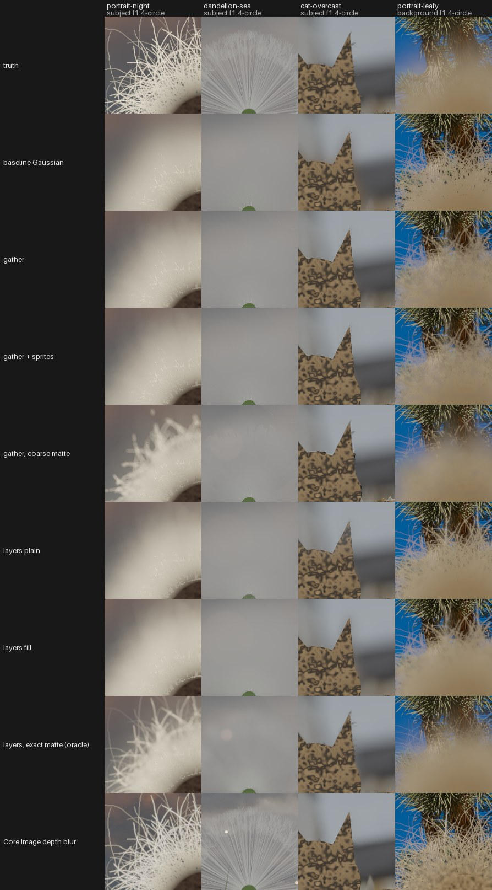
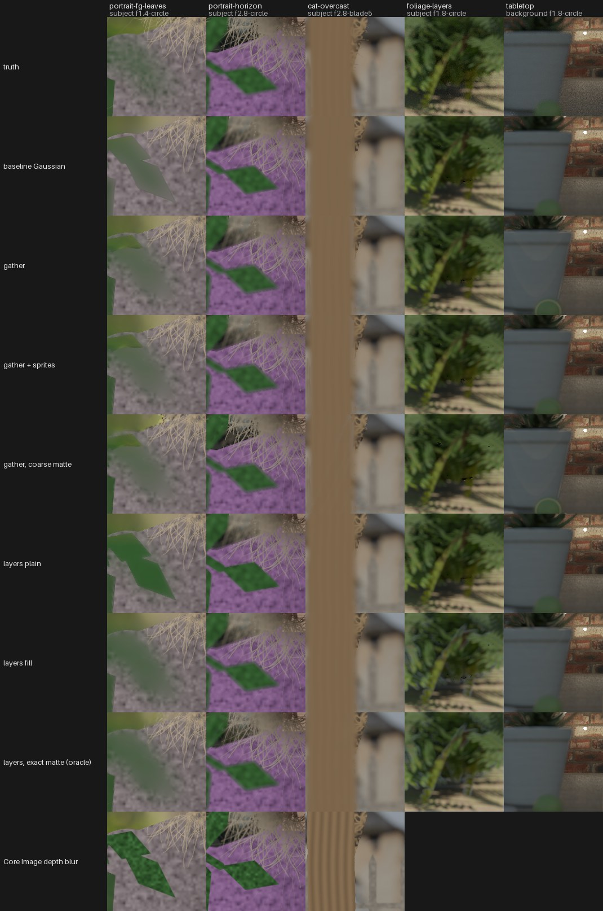
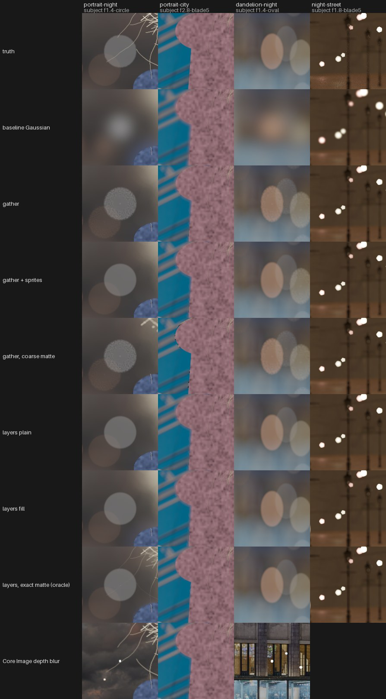
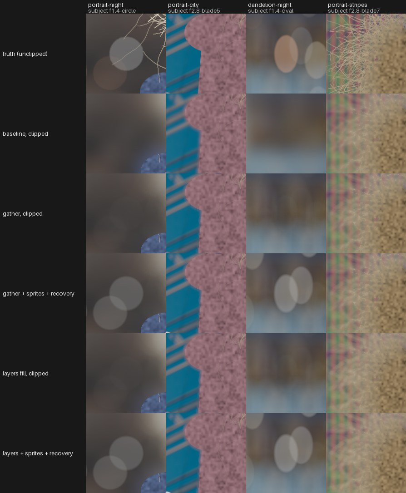

# OTH-03: Lens blur

What it would take for Redlamp to have a lens blur (synthetic shallow depth of field from one photo and its depth) that does what Lightroom's Lens Blur does and more, especially on phone photos. Tracker row OTH-03, issue [#138](https://github.com/pdcgomes/redlamp/issues/138). Started 13 October 2026.

This note holds the desk study (sections 0 to 7) and the measurements (8 to 11): what they settle, the exact-truth benchmark, the renderers and the depth bake-off. The iPhone's files and the comparison with Lightroom follow once the owner's photos and Lightroom's exports are in. The design built on them is [docs/plans/2026-10-14-lens-blur-design.md](../../plans/2026-10-14-lens-blur-design.md). The fetched pages and scripts the desk study drew on were working material and are not kept.

Builds on [C-masking §4](C-masking.md#4-depth-depth-range-mask-and-lens-blur) and [F-other §1](F-other.md#1-lens-blur-synthetic-depth-of-field-with-bokeh-shapes) (September 2026), which it does not repeat. Licences were read on 2026-10-13 from the primary sources named inline (`gh api repos/<owner>/<repo>/license`, the repository README, the Hugging Face API's `cardData.license`). Verdicts follow [`_conventions.md`](_conventions.md); a second column applies the owner's rule DEC-24 (follow the weights' licence; never ship a model trained directly on Places2). Anything not confirmed from a source in this session is marked **UNVERIFIED**.

## 0. Desk study: findings that bear on decisions

1. **Lightroom's XMP stores settings, not the depth.** `crs:LensBlur` holds 17 fields plus `ImageOrientation`; `crs:DepthMapInfo` holds only digests and version numbers of three cached products (raw depth, *layered* depth and a *highlight guide*); refinement brush strokes have their own list, `crs:DepthBasedCorrections`. A Lightroom edit can be imported as settings, but its depth must be regenerated, as Lightroom itself does when it asks to "update AI settings".
2. **Adobe's renderer matches three Adobe patent filings,** one of them now granted: US12586163B2 (granted 24 March 2026, adjusted expiry 16 April 2044) claims refining a *layered* depth map against a focal matte, by focus range and correction mode. That is close to Lightroom's Focus and Blur brushes that "adapt to later Focus Range changes". Redlamp's refinement design should go to counsel (DEC-05) before it is built.
3. **The depth model to evaluate first is MoGe-2 ViT-S or ViT-B (MIT weights, no Places in its paper), then Depth Anything 3 Small and Base (Apache-2.0).** Depth Anything 3 Mono-L, which Redlamp already ships, trains its student on unlabeled images "following the DA2 framework", without naming them. Depth Anything V2's unlabeled set includes Places365, so Mono-L is probably trained directly on Places365 (**UNVERIFIED**). It ships under the DEC-02 exception, so nothing changes now, but the exception covers more than its record says. Pixel-Perfect Depth (Apache-2.0) is the edge-quality reference, at diffusion cost.
4. **No bokeh dataset with real photographs is cleanly usable for evaluation.** EBB! states no licence; RealBokeh is CC BY-NC-SA 4.0 ("only permitted for non-commercial purposes"); BokehMe's BLB states no data terms. The clean option is a set the owner shoots himself, the same scenes at f/1.4 and at f/11 to f/16 on a tripod, plus Blender scenes we render ourselves.
5. **The only ProRAW sample checked has no depth.** The repository's iPhone 12 Pro ProRAW (`tests/fixtures/raw/IMG_1361.DNG`) holds a raw IFD and one DNG 1.6 semantic mask, the sky matte (`urn:com:apple:photo:2020:aux:semanticskymatte`, 2016 × 1512, 8-bit). It has no DNG depth tags and no depth IFD. Newer iPhones are **UNVERIFIED**.
6. **The iPhone records Portrait's aperture and focus in an Apple "portrait metadata" set.** Apple's capture framework exports `kFigApplePortraitMetadata` with `ApertureFocalRatio`, `Minimum`/`MaximumApertureFocalRatio`, `FocusRectangle`, `LuminanceNoiseAmplitude`, `PortraitLightingEffectStrength`, `SDOFRenderingVersion` and face landmarks. Photos reads them back with `PIValuesAtCapture valuesAtCaptureFromImageProperties:`, that is, from the image file's own properties. Which container in the file holds them (a MakerApple tag or the depth image's metadata) is **UNVERIFIED** and needs sample files. Core Image's public `CIDepthBlurEffect` takes the same quantities as inputs (aperture 0–22, focus rectangle, luma noise scale 0–0.1, face landmarks, hair, glasses and portrait mattes).

## 1. Lightroom's Lens Blur

### 1.1 Controls and behaviour

Sources: Adobe's Camera Raw help page (Wayback copy of 15 February 2026; page last updated 12 December 2024) [ACR]; the Lightroom Classic page (copy of 13 June 2026; page updated 10 October 2025) [LrC]; the Lightroom (desktop) page (copy of 12 November 2025) [LR]; Josh Bury's post [Bury]. `helpx.adobe.com` refuses the sandbox, but the Wayback Machine's copies load.

- [ACR] <https://web.archive.org/web/20260215094055/https://helpx.adobe.com/camera-raw/using/lens-blur.html>
- [LrC] <https://web.archive.org/web/20260613022825/https://helpx.adobe.com/lightroom-classic/help/lens-blur.html>
- [LR] <https://web.archive.org/web/20251112063341/https://helpx.adobe.com/lightroom-cc/using/lens-blur.html>
- [Bury] <https://blog.adobe.com/en/publish/2024/06/26/inside-lens-blur>

| Control | What the sources say |
|---|---|
| Apply | Desktop: "add Lens Blur to a photo by checking Apply. On mobile, drag the blur slider to activate. There will be a short delay as we estimate the scene depth" [Bury]. |
| Initial focus | "takes advantage of Select Subject to set the initial focus range setting for the subject" [Bury]. |
| Blur Amount | "The slider is set at 50 by default" [ACR]. |
| Bokeh shape | Circle ("Modern circular lens"), Bubble ("over-corrected spherical aberration"), 5-blade, Ring ("reflex or mirror lenses … Doughnut"), Anamorphic / Oval / Anamorphic ("an oval appearance") [ACR], [LR]. At launch the fifth button was Cat Eye [Bury]. |
| Cat Eye | A slider "to achieve a swirling, crescent-shaped blur effect toward the edges and corners" [ACR]. Since December 2024 a slider on desktop, applicable to any shape; still a button on mobile ([Lightroom Queen, December 2024](https://www.lightroomqueen.com/whats-new-in-lightroom-2024-12/)). |
| Boost (Bokeh Boost) | "adjust the brightness of out-of-focus light sources" [ACR]; driven by "a dedicated step for detecting out-of-focus light sources" [Bury]. |
| Focus Range | A range of depth values in focus; "expand or contract the slider box by holding and dragging it from either side" [LrC]. It shows a histogram: a December 2023 bug reads "Lens Blur's Focal Range histogram doesn't update when Use Device Map is toggled" ([LRQ 2023-12](https://www.lightroomqueen.com/whats-new-in-lightroom-2023-12/)). |
| Subject Focus | "Automatically sets the focal range using AI-powered subject detection" [ACR]. |
| Point / Area Focus | "Manually set the focal range by clicking or dragging on the photo" [ACR]. |
| Visualize Depth | Overlay colours: "Warm or Yellow … near", "Cool or Blue … far", "White … currently in focus", the white "only visible while adjusting the focal range slider" [ACR]. |
| Refinement | Focus and Blur brushes with Amount, Brush Size, Feather, Flow and Auto Mask; a Reset icon [ACR]. Blur "can also be used to increase the strength of blur locally in areas just outside of the focal range" [ACR]. Refinements "are also adaptive to changes in the Focus Range" [Bury]. Desktop apps only: "we offer refinement brushes in Lightroom on desktop, Lightroom Classic, and ACR" [Bury]. |
| Device depth | "Lens Blur supports Device Depth for images like .HEIC that already has a depth map" [ACR]; "If a photo has an existing depth map, Lens Blur will use it, unless you specify otherwise" [LR]. The toggle is "Use Device Depth" [Bury] (a bug calls it "Use Device Map"). |
| Copy / Paste / Sync | Since 13.3 (May 2024). When copying, "select Focus on Subject if you want Lightroom to automatically detect the subject in each photo … Focus settings from the source image will apply If Focus on Subject isn't selected" [LrC]. |
| Presets | Adaptive: Blur Background: "Subtle, Strong, Circle, Circle Swirl, Bubble, Bubble Swirl, Geometric, Geometric Swirl, Ring, Ring Swirl, Oval, Oval Swirl", with a preset Amount slider; they "use AI to identify the subject and scan the scene" [LrC]. |

Adobe's own caveats [Bury]: it "cannot remove existing blur"; "finely detailed or narrow subjects such as ropes, fly-away hair, or foliage" are hard; add Grain to the blurred areas, through a mask; turn off the phone's own Portrait blur before importing; and "adjusting Lens Blur will never be as fast as … adjusting Exposure".

### 1.2 Release history

| Date (version) | Change | Source |
|---|---|---|
| October 2023 (LrC 13.0, ACR 16) | Early Access; uses iPhone Portrait depth maps | [LRQ 2023-10](https://www.lightroomqueen.com/whats-new-in-lightroom-2023-10/); ExifTool's table marks `LensBlur` "new for ACR 16" ([XMP.pm](https://github.com/exiftool/exiftool/blob/master/lib/Image/ExifTool/XMP.pm)) |
| December 2023 | Bug naming "Use Device Map" and the Focal Range histogram | [LRQ 2023-12](https://www.lightroomqueen.com/whats-new-in-lightroom-2023-12/) |
| February 2024 (13.2) | "Uses Lens Blur" filter for smart collections; Android: "Not rendering on export when using Lens Blur" | [LRQ 2024-02](https://www.lightroomqueen.com/whats-new-in-lightroom-2024-02/) |
| May 2024 (13.3) | General availability, "AI models have been improved", Copy/Paste/Sync/Auto Sync, Focus Range slider on mobile | [LRQ 2024-05](https://www.lightroomqueen.com/whats-new-in-lightroom-2024-05/) |
| October 2024 (14.0) | Bug: "Snapshots don't record Lens Blur brush refinements" | [LRQ 2024-10](https://www.lightroomqueen.com/whats-new-in-lightroom-2024-10/) |
| December 2024 (14.1) | Oval/Anamorphic shape; Cat Eye becomes a slider on desktop; Lens Blur presets in Adaptive: Blur Background | [LRQ 2024-12](https://www.lightroomqueen.com/whats-new-in-lightroom-2024-12/) |
| June 2025 (14.4) | AI settings status icon: Lens Blur listed among settings recreated when pixels change (after Remove); bug "Export Fails … when Lens Blur is used" | [LRQ 2025-06](https://www.lightroomqueen.com/whats-new-in-lightroom-2025-06/) |
| October 2025 (15.0) | Bug: "Focus On Subject ignored when copying Lens Blur from master to a virtual copy" | [LRQ 2025-10](https://www.lightroomqueen.com/whats-new-in-lightroom-2025-10/) |
| December 2025 | Bug: "Lens Blur Visualize Depth not working"; a reader on iPad: "Update AI edits, Some settings require online access … Lens blur ticked" | [LRQ 2025-12](https://www.lightroomqueen.com/whats-new-in-lightroom-2025-12/) |
| February 2026 | Bugs: "AI Edit Status > Update must be invoked twice for Lens Blur on top of Subject Mask"; "Using the Remove tool stops the display of Lens Blur settings" | [LRQ 2026-02](https://www.lightroomqueen.com/whats-new-in-lightroom-2026-02/) |
| April 2026 | Community thread "Lens Blur stopped working suddenly since 4/20/2026"; Adobe's reply (search snippet): "There is currently an outage related to this" | [community.adobe.com](https://community.adobe.com/questions-680/p-lens-blur-stopped-working-suddenly-since-4-20-2026-1558470) (thread not opened; snippet only, **UNVERIFIED** in full) |

The posts for April and June 2026 have no new Lens Blur features. The December 2025 comment and the April 2026 outage suggest that some step needs Adobe's servers, at least on some platforms. Neither source says which step, so this is **UNVERIFIED**.

### 1.3 What Lightroom writes to XMP

Field names come from ExifTool's tag table ([XMP.pm, `LensBlur`, `DepthMapInfo`, `DepthBasedCorrections`](https://github.com/exiftool/exiftool/blob/master/lib/Image/ExifTool/XMP.pm); rendered at <https://exiftool.org/TagNames/XMP.html#crs>), checked against XMP files Lightroom wrote, found with `gh search code`:

- defaults, inactive: [Questtion/Lightroom-Presets `FDD Preset 1.xmp`](https://github.com/Questtion/Lightroom-Presets/blob/10e36149ab94e41a702946075ae30195c23af77e/Presets/FDD%20Preset%201.xmp)
- an applied blur: [sarahgretener1/mySpace `_DSC7053.xmp`](https://github.com/sarahgretener1/mySpace/blob/b841cc2f87885618c59578fc192507dbe8e4665a/img/_DSC7053.xmp)
- `FocalRangeSource="3"`: [GlutenJager/poland_rewritten_cop](https://github.com/GlutenJager/poland_rewritten_cop/blob/4c380f4ce5964740ce078d0cc46a6adf369544e2/dev_stuff/graficzki/logo/HTB1eu1py2iSBuNkSnhJq6zDcpXai.jpg_q50.xmp)

**`crs:LensBlur`** (one struct):

| Field | Type (ExifTool) | Seen | Meaning |
|---|---|---|---|
| `Version` | string | `1` | |
| `Active` | boolean | `false`, `true` | the Apply checkbox |
| `ImageOrientation` | — (not in ExifTool's table) | `0` | written by Lightroom; meaning **UNVERIFIED** |
| `BlurAmount` | real (flat name `LensBlurAmount`) | `50` | Blur Amount; 50 matches the documented default |
| `BokehShape` | real | `0` | shape index; only 0 seen, so the index-to-shape mapping is **UNVERIFIED** |
| `BokehShapeDetail` | real | `0` | **UNVERIFIED**, possibly a per-shape parameter |
| `BokehAspect` | real | `0` | probably Oval/Anamorphic's squeeze (**UNVERIFIED**) |
| `BokehRotation` | real | `0` | not in the UI; **UNVERIFIED** |
| `CatEyeAmount` | real | `0` | Cat Eye slider |
| `CatEyeScale` | real | `100` | not in the UI |
| `HighlightsBoost` | real | `50` | Boost |
| `HighlightsThreshold` | real | `50` | not in the UI; the light-source threshold |
| `SphericalAberration` | real | `0` | not in the UI; probably what makes Bubble (**UNVERIFIED**) |
| `FocalRange` | string, four numbers | `0 0 100 100` inactive; `-80 0 53 133`; `-80 0 100 180` | the Focus Range. In both applied samples the outer two numbers are the inner two ∓80, which reads as near-feather start, in-focus start, in-focus end, far-feather end on a 0–100 depth scale (inference, **UNVERIFIED**) |
| `FocalRangeSource` | real | `1` (with `SubjectRange`), `3` | how the range was set (subject, point, manual); mapping **UNVERIFIED** |
| `SubjectRange` | string | `0 53` | the range Select Subject found |
| `SampledArea` | string | `0.500000 0.500000 0.500000 0.500000` | Point/Area Focus rectangle, normalised |
| `SampledRange` | string | `0 0` | depth range under the sampled area |

**`crs:DepthMapInfo`**: `DepthSource` (seen `2`), and for each of `BaseRawDepth`, `BaseLayeredDepth` and `BaseHighlightGuide` a `…Table` (a 128-bit identifier), an `…InputDigest` and a `…Version` (seen 12, 1 and 1). The depth itself is not in the XMP: these name cached data Lightroom keeps elsewhere and rebuilds. The names match Bury's "depth information that's more sophisticated than a basic depth map", and match the claims of Adobe's filings in §6 ("layered depth map", "highlight guide image").

**`crs:DepthBasedCorrections`** (a `Seq` of structs, flat name `DepthBasedCorr`): `What`, `CorrectionActive`, `CorrectionAmount`, `CorrectionSyncID`, `LocalCorrectedDepth`, `LocalCurveRefineSaturation`, and `CorrectionMasks`, a mask list with the usual brush fields (`Dabs`, `Feather`, `Flow`, `CenterWeight`, `MaskVersion` and so on). These are the Focus and Blur brush strokes. No file in the wild with this list turned up (`gh search code "LocalCorrectedDepth"` found only copies of ExifTool), so how a stroke encodes Focus against Blur is **UNVERIFIED**.

Range masks also carry `DepthMin`, `DepthMax`, `DepthFeather` and `LuminanceDepthSampleInfo` (Depth Range masks; ExifTool, same file).

Redlamp ignores `LensBlur` when it reads a Lightroom preset today (`LightroomPresetMapping.swift`, `docs/recipes/lightroom-presets.md`: "ignored: Redlamp has no Lens Blur yet").

### 1.4 What users report

- Halos around the subject: "Every time I'm trying to apply Lens Blur in lightroom, I get a horirble halo effect around the subject. I'm able to fine tune this with a brush but it's so tedious"; a second user: "it is taking forever to brush the edges" (May 2025, [community.adobe.com](https://community.adobe.com/questions-675/lens-blur-halo-effect-982224)). A community expert put it down to "a very poor initial depth mask" and the GPU.
- Refinement brushes hanging: after 13.3 "the program just shows the spinning progress icon … and does nothing other than put streaks of blur following my cursor" (June 2024, [Lightroom Queen forum](https://www.lightroomqueen.com/community/threads/huge-lens-blur-problem-with-13-3.50491/)).
- Lens Blur that stops working after a while in Lightroom Classic 15, until the cache is cleared ([Ask Tim Grey, 24 November 2025](https://asktimgrey.com/2025/11/24/lens-blur-adjustment-failing/), from its search snippet; **UNVERIFIED** in full).
- Adobe's own list of hard subjects: ropes, fly-away hair, foliage [Bury].

### 1.5 Mobile and desktop

| | Desktop (Classic, Lightroom, ACR) | Mobile (iOS, Android) |
|---|---|---|
| Turn on | Apply checkbox | drag the Blur slider [Bury] |
| Focus Range slider | from launch | from May 2024 [LRQ 2024-05] |
| Refinement brushes | yes | no [Bury] |
| Cat Eye | slider since December 2024 | button [LRQ 2024-12] |
| Bugs specific to it | — | Android export didn't render Lens Blur (February 2024) |

Whether the mobile apps run depth estimation on the device is **UNVERIFIED** (a Reddit post about a modified Android build says the photo "is send to cloud for processed by AI", which isn't a reliable source).

## 2. Competitors

| Product | Depth source | Shapes | Beyond Lightroom | Source |
|---|---|---|---|---|
| Apple Photos (iPhone, iPad, Mac) | the capture's disparity and mattes | circular (**UNVERIFIED**) | refocus after capture; on iPhone 15 and later, "When there's a person, dog, or cat in the frame, or when a user taps to focus, iPhone automatically captures depth information, so users can turn photos into stunning portraits later in the Photos app on iPhone, iPad, or Mac … users can also adjust the focus point after the photo has been taken" | [Apple Newsroom, 12 September 2023](https://www.apple.com/newsroom/2023/09/apple-unveils-iphone-15-pro-and-iphone-15-pro-max/) |
| Core Image `CIDepthBlurEffect` (Apple's public renderer) | disparity plus portrait, hair and glasses mattes, gain map | `inputShape` (a string; values **UNVERIFIED**) | aperture (0–22, slider 1–22), focus rectangle, luma noise (0–0.1), face landmarks (eyes, nose, chin) | queried on this Mac, macOS 26.6.2 (§5.4) |
| Google Pixel / Google Photos | dual-pixel disparity plus person segmentation (Pixel 2) | disc | renders in linear light "to preserve highlights", composites disparity layers to avoid halos, adds synthetic noise afterwards | [Wadhwa et al. 2018](https://arxiv.org/abs/1806.04171); [Google Research blog](https://research.google/blog/portrait-mode-on-the-pixel-2-and-pixel-2-xl-smartphones/). Google Photos' Portrait blur for photos without depth: blog pages tried returned 404, **UNVERIFIED** |
| Samsung Galaxy (Portrait / Live focus) | dual camera or estimated | several styles | **UNVERIFIED**: the support page tried returned nothing useful | — |
| Photoshop, Filter › Blur › Lens Blur | an alpha channel, a layer mask or transparency, with "Blur Focal Distance" and Invert | iris from the blade count, Blade Curvature, Rotation | Specular Highlights Threshold and Brightness; Noise Amount, Uniform or Gaussian, Monochromatic; since 21.1 (February 2020) "blurrier edges for foreground objects, brighter bokehs, and more realistic specular highlights" | [Adobe help, Wayback copy 2023](http://web.archive.org/web/2023/https://helpx.adobe.com/photoshop/using/adjusting-image-sharpness-blur.html) |
| Photoshop Blur Gallery (Field, Iris, Tilt-Shift) | none (pins) | — | Light Bokeh, Bokeh Color, Light Range; Noise tab to restore grain | [Adobe help, Wayback copy 11 October 2026](https://web.archive.org/web/20261011225251/https://helpx.adobe.com/photoshop/using/blur-gallery.html) |
| Photoshop Neural Filter: Depth Blur | estimated | — | haze and warmth of the surroundings; "Depth Blur (Beta) process[es] some operations in the cloud" | [Neural Filters FAQ](https://web.archive.org/web/20260417012653/https://helpx.adobe.com/photoshop/using/neural-filters-list-and-faq.html) |
| Focos (iOS, iPadOS) | "The AI engine can calculate depth of field automatically for all photos", plus Portrait depth | "various simulated aperture diaphragms" | lens characters ("creamy, bilinear, swirly, and reflex"), 3D depth view, lights placed in 3D, depth-map patching on iPad, refocus with a tap | [App Store](https://apps.apple.com/us/app/focos/id1274938524) |
| RapidRAW | Depth Anything V2 Small | — | "turns depth into a signed blur radius that fades on either side of the range in focus, after refining the depth with a guided filter against the photo" | `docs/research/rapidraw-findings.md` |
| ON1 Photo RAW | "AI Depth Masks … foreground, midground, background" | — | no lens blur found on the product page | [on1.com](https://www.on1.com/products/photo-raw/) |
| Luminar Neo Portrait Bokeh | — | — | **UNVERIFIED** (product page 404) | — |
| Affinity Photo | — | — | Lens Blur and Depth of Field filters exist; **UNVERIFIED** (affinity.help returns 403) | — |
| Pixelmator Pro | — | — | **UNVERIFIED** (guide page 404) | — |

What the others have that Lightroom doesn't: aperture blades, curvature and rotation (Photoshop); noise or grain restored inside the blur (Photoshop, Pixel); an exposed highlight threshold (Photoshop; Lightroom stores one in XMP but doesn't show it); lens characters and lights placed in depth (Focos); the capture's own hair and glasses mattes at the edges (Core Image).

## 3. Methods

The classic real-time papers' DOIs resolve (checked with `doi.org/api/handles` on 2026-10-13), but their publishers refuse the proxy. Their descriptions below are from the literature as generally summarised and were not re-read for this draft: **UNVERIFIED** in detail. The phone and learned methods were read on arXiv in this session.

| Method | What it does | Cost | Depth edges and partial occlusion | Highlights | Aperture shapes |
|---|---|---|---|---|---|
| Potmesil & Chakravarty 1981, [10.1145/800224.806818](https://doi.org/10.1145/800224.806818) | post-process: each pixel spreads as its circle of confusion from a lens model | scatter, O(N·r²) | none: no visibility, so blurred foregrounds have hard edges | — | circle |
| Kass, Lefohn & Owens 2006, [Pixar memo 06-01](https://graphics.pixar.com/library/DepthOfField/paper.pdf) | blur as heat diffusion, solved with an implicit ADI step per row and column | linear in pixels, independent of radius | layers (midground, background) to limit bleeding; partial occlusion approximate | weak (diffusion has no bokeh shape) | Gaussian-like only |
| Kraus & Strengert 2007, [10.1111/j.1467-8659.2007.01064.x](https://doi.org/10.1111/j.1467-8659.2007.01064.x) | splits the image into depth layers, fills each hidden region by pyramid pull-push, blurs each with a pyramid and composites back to front | about constant per pixel | handles disocclusion behind foregrounds | weak | smooth |
| Lee, Eisemann & Seidel 2009, [10.1145/1618452.1618480](https://doi.org/10.1145/1618452.1618480); 2010, [10.1145/1778765.1778802](https://doi.org/10.1145/1778765.1778802) | layered depth images ray-traced through the lens aperture (2010: real-time lens blur and focus control) | GPU, many rays per pixel | correct partial occlusion from the layers | yes | any |
| McIntosh, Riecke & DiPaola 2012, [10.1111/j.1467-8659.2012.02097.x](https://doi.org/10.1111/j.1467-8659.2012.02097.x) | polygonal apertures from intersecting separable 1D line blurs | separable: O(r) per pixel per pass | gather with depth tests | yes | polygons |
| Jimenez 2014, [Call of Duty: Advanced Warfare post-processing, SIGGRAPH 2014 course](http://www.iryoku.com/next-generation-post-processing-in-call-of-duty-advanced-warfare) (link didn't load) | scatter-as-gather in half resolution, separate near and far fields, sample weights by circle of confusion | games-real-time | near field blurred over the in-focus image | yes | circle (polygons by sampling) |
| McGraw 2015, [10.1007/s00371-014-0986-6](https://doi.org/10.1007/s00371-014-0986-6) | aperture kernels approximated as sums of separable rank-1 filters (SVD) | a few separable passes | not addressed | yes | any shape, approximately |
| Garcia 2017, [10.1145/3084363.3085022](https://doi.org/10.1145/3084363.3085022) | circle as a sum of complex Gaussian-like separable kernels (EA Frostbite) | two passes per component | near and far handled separately | yes | circle |
| Abadie 2018, [A Life of a Bokeh, SIGGRAPH 2018 Advances](https://advances.realtimerendering.com/s2018/index.htm) | Unreal Engine 4's DoF: tile-based scatter of bright pixels, gather for the rest, careful near-field handling | games-real-time | slight foreground-over-focus bleed by design | scatters bright pixels as sprites | blade count, curvature |
| Gustafsson 2018, [single-pass bokeh](https://blog.voxagon.se/2018/05/04/bokeh-depth-of-field-in-single-pass.html) | one gather on a spiral, each sample weighted by whether its own circle reaches the pixel | one pass | approximate | yes | circle |
| Wadhwa et al. 2018, [arXiv 1806.04171](https://arxiv.org/abs/1806.04171) (Google Pixel) | disk kernels applied "to sub-images covering different ranges of disparity values", then "composite the intermediate results, gamma-correct, and add synthetic noise"; a forced-zero blur zone around the focal plane keeps the whole subject sharp | phone; radius capped at 30 px | the paper shows that a naive gather "causes the foreground to bleed into the background" and that a single pass blurs the background over the foreground; layered compositing prevents both | renders in "a linear color space … to preserve highlights" | disc |
| Ignatov et al. 2020, EBB!, [arXiv 2006.05698](https://arxiv.org/abs/2006.05698) | PyNET learns phone to DSLR bokeh end to end, with estimated depth as input | network | learned | learned | the Canon lens's |
| Peng et al. 2022, BokehMe, [arXiv 2206.12614](https://arxiv.org/abs/2206.12614) | classical scatter renderer plus a neural renderer that repairs errors at depth discontinuities | network on a few regions | the point of the paper | from the classical part | controllable |
| Peng et al. 2022, MPIB, [arXiv 2207.06917](https://arxiv.org/abs/2207.06917) | multiplane image with learned inpainting of hidden background, then layered rendering | network plus layers | partial occlusion of blurred foregrounds | yes | controllable |
| Sheng et al. 2024, Dr.Bokeh, [arXiv 2308.08843](https://arxiv.org/abs/2308.08843) | differentiable, occlusion-aware layered renderer; paper only (§3.2) | — | yes | yes | yes |
| Fortes et al. 2025, Bokeh Diffusion, [arXiv 2503.08434](https://arxiv.org/abs/2503.08434) | defocus as a control for text-to-image generation (FLUX) | diffusion | generated, not rendered | generated | — |
| Zhu et al. 2025, BokehDiff, [arXiv 2507.18060](https://arxiv.org/abs/2507.18060) (ICCV 2025) | one-step diffusion lens blur conditioned on depth, evaluated on EBB! | one diffusion step at full size | learned | learned | — |
| Seizinger et al. 2025, Bokehlicious, [arXiv 2503.16067](https://arxiv.org/abs/2503.16067) (ICCV 2025) | network with aperture control; introduces RealBokeh | network | learned | learned | aperture-controlled |
| Shi et al. 2026, MagicBokeh, [arXiv 2605.07429](https://arxiv.org/abs/2605.07429) (CVPR 2026, vivo) | diffusion bokeh for low-resolution, zoomed phone photos, on Stable Diffusion 2.1 | diffusion | learned | learned | — |
| Zhang et al. 2025, BokehDepth, [arXiv 2512.12425](https://arxiv.org/abs/2512.12425) | uses bokeh rendering to improve monocular metric depth, and the reverse | network | — | — | — |
| NTIRE 2026 Controllable Bokeh Rendering Challenge, [arXiv 2605.05510](https://arxiv.org/abs/2605.05510) | 8 valid entries, "most … refining and extending the Bokehlicious baseline" | — | — | — | — |

"GenRefocus" was not found on arXiv by that name (**UNVERIFIED**).

**Code and weights licences** (2026-10-13):

| Project | Code licence (verbatim or SPDX, source) | Weights | Verdict |
|---|---|---|---|
| BokehMe | Apache-2.0 ([LICENSE](https://github.com/JuewenPeng/BokehMe)) | in the repo, no separate terms | **UNCLEAR** weights; the classical part can be reimplemented from the paper |
| MPIB | Apache-2.0 ([LICENSE](https://github.com/JuewenPeng/MPIB)) | no separate terms | **UNCLEAR** |
| Dr.Bokeh | none: `gh api repos/ShengCN/DrBokeh/license` and `…/DrBokeh-Src/license` both 404 | — | **Avoid** code; paper only |
| Bokeh Diffusion | "S-Lab License 1.0 … Redistribution and use for non-commercial purpose" ([LICENSE](https://github.com/atfortes/BokehDiffusion/blob/main/LICENSE)) | FLUX-based | **Research-only** |
| BokehDiff | Apache-2.0 text ("Licensed under the Apache License, Version 2.0", [LICENSE](https://github.com/FreeButUselessSoul/bokehdiff)) | the paper mentions SDXL and FLUX; which base model the weights derive from is **UNVERIFIED** | **UNCLEAR** (base model terms) |
| Bokehlicious | no LICENSE file (API 404); README: "If you would like to use this code or dataset for commercial purposes, check the license and contact us" | — | **Avoid** |
| MagicBokeh | no LICENSE file (API 404); SD 2.1 base | — | **Avoid** |
| PyNET-Bokeh (EBB!) | CC BY-NC-SA 4.0 ([LICENSE](https://github.com/aiff22/PyNET-Bokeh)) | — | **Research-only** |

Assessment. Lightroom's described behaviour (layered depth, a separate highlight-detection step, edges rendered from extra depth information) is the Wadhwa / Kraus-Strengert family: layers composited back to front, in linear light, with highlights found before blurring. That family is classical, fits Metal, and needs no learned renderer. The learned renderers above either can't ship or add little that layering, a matte at the subject's edge (C's matting) and in-painted background behind foregrounds (MPIB's idea, with RM-07's fill) don't. The diffusion methods invent pixels and cost seconds; not suited to a slider.

### 3.1 Datasets for evaluation

| Dataset | Content | Terms, verbatim | Evaluation use |
|---|---|---|---|
| EBB! (Ignatov et al. 2020) | "200 image pairs were reserved for testing, while the other 4.8 thousand photo pairs can be used for training and validation"; shallow depth-of-field photos "captured with a professional Canon 7D DSLR camera" ([PyNET-Bokeh README](https://github.com/aiff22/PyNET-Bokeh)) | The page states no licence: "You can now download its training part (without the depth data) by registering in the above challenge" (AIM 2020) ([page](https://aiff22.github.io/pynet-bokeh.html)) | **UNCLEAR**: no terms stated; the challenge's registration terms were not read |
| BLB (BokehMe) | 10 Blender scenes, 5 blur amounts × 10 focal disparities each | README states none ("can be downloaded from Google Drive or Baidu Netdisk"); the repository's Apache-2.0 doesn't clearly cover data hosted elsewhere ([README](https://github.com/JuewenPeng/BokehMe#blb-dataset)) | **UNCLEAR** |
| RealBokeh 3MP (Bokehlicious) | real pairs at several apertures | HF `license: cc-by-nc-sa-4.0`; "the use of this dataset is only permitted for non-commercial purposes" ([card](https://huggingface.co/datasets/timseizinger/RealBokeh_3MP)) | **Research-only**; whether internal benchmarking for Redlamp is "non-commercial" is counsel's question |
| Our own | the same scenes, tripod, a fast lens wide open and stopped down; iPhone Portrait and Photo-mode captures with depth | ours | **Clean.** The owner can shoot them through Redlamp Bench (`.cursor/skills/redlamp-bench`) |
| Our own synthetic | Blender scenes rendered with a real thin-lens camera, like BLB | ours (Blender's GPL doesn't cover its renders) | **Clean**, and exact for edges and highlights |

## 4. Depth models for lens blur

What matters is depth at the subject's outline: a model that smears depth across an edge ("flying pixels") gives the halo users complain about. MoGe-2 measures boundary sharpness and reports that "training exclusively on synthetic data yields the highest sharpness but significantly reduces geometric accuracy" ([arXiv 2507.02546](https://arxiv.org/abs/2507.02546)); Pixel-Perfect Depth says a VAE "inevitably introduces flying pixels at edges", which is why it diffuses in pixel space ([arXiv 2510.07316](https://arxiv.org/abs/2510.07316)).

Training data was checked by searching each paper's arXiv HTML for dataset names, Places included. "No Places" means the paper never mentions Places or Places365.

| Candidate | Code licence | Weights licence (HF `cardData.license` unless noted) | Training data | Places2/365? | Conventions verdict | DEC-24 |
|---|---|---|---|---|---|---|
| **DA3-Small** (0.08B) | Apache-2.0 ([repo](https://github.com/ByteDance-Seed/Depth-Anything-3)) | `apache-2.0`; README "Apache 2.0" | the paper's Table 1 (AriaDigitalTwin, ArkitScenes, BlendedMVS, Co3dv2, DL3DV, HyperSim, MapFree …) with teacher pseudo-depth from a synthetic-trained teacher | not in the paper | **UNCLEAR** (mixed academic terms) | passes |
| **DA3-Base** (0.12B) | Apache-2.0 | `apache-2.0`; README "Apache 2.0" | same | not in the paper | **UNCLEAR** | passes |
| DA3Mono-Large (0.35B; shipped) | Apache-2.0 | `apache-2.0`; README "Apache 2.0" | "We follow the DA2 framework, training the monocular student on unlabeled images with teacher-generated pseudo-labels" (§4.3); the images aren't named. DA2's unlabeled set (its Table 7) includes "Places365" | **probably, UNVERIFIED** | **UNCLEAR** | probably fails; shipped under the DEC-02 exception |
| DA3Metric-Large | Apache-2.0 | `apache-2.0` | teacher labels and metric sets, not itemised here | **UNVERIFIED** | **UNCLEAR** | **UNVERIFIED** |
| DA3-Large, -Giant, Nested | Apache-2.0 | README "CC BY-NC 4.0"; HF `DA3-LARGE-1.1` says `apache-2.0` (contradiction) | — | — | **Research-only** (UNCLEAR for Large-1.1) | fails |
| **MoGe-2 ViT-S / B / L** | MIT, "except for DINOv2 code … Apache 2.0" ([README](https://github.com/microsoft/MoGe)) | `mit` (`Ruicheng/moge-2-vits-normal`, `-vitb-normal`, `-vitl-normal`, `-vitl`) | "a large corpus of mixed datasets", synthetic and real, the real filtered and completed by a synthetic-trained model. Names in the paper include Hypersim, TartanAir, IRS, Spring, Synscapes, MVS-Synth, UnrealStereo4K, Objaverse, MegaDepth, ScanNet, ARKitScenes and Waymo; which of them are training rather than test sets was not checked | not in the paper | **UNCLEAR** | passes |
| Depth Pro | Apple sample-code licence | `apple-amlr`, research only | — | — | **Research-only** | excluded |
| Apple SHARP (ml-sharp) | Apple sample-code licence | `apple/Sharp`: `apple-amlr`; LICENSE_MODEL "exclusively for Research Purposes" | — | — | **Research-only** | excluded |
| Marigold v1.1 / LCM | Apache-2.0 | v1.1 `openrail++` ("RAIL++-M", README); LCM v1.0 `apache-2.0` | Stable Diffusion 2 (LAION), Hypersim, Virtual KITTI | not in the paper | **UNCLEAR**; heavy | passes (RAIL use limits apply) |
| Lotus | Apache-2.0 | `apache-2.0` | SD2 lineage; Hypersim, Virtual KITTI | not in the paper | **UNCLEAR**; heavy | passes |
| Metric3D v2 | BSD-2-Clause | publisher's terms not stated; `onnx-community/metric3d-vit-small` says `cc0-1.0`, but it's a third party's conversion | 16M images from many sets | not in the paper | **UNCLEAR** | **UNVERIFIED** |
| UniDepth v2 | "Creatives Common BY-NC 4.0" (README) | HF has no `license` field | — | — | **Avoid** | fails |
| Distill-Any-Depth | MIT | `xingyang1/Distill-Any-Depth-{Small,Large}-hf`: `mit`; `xingyang1/Distill-Any-Depth`: `apache-2.0` | SA-1B images, distilled "from Genpercept and DepthAnythingv2" | not directly | **UNCLEAR** (a teacher may be DA-V2 Large, CC BY-NC) | passes on the letter |
| **Pixel-Perfect Depth** | Apache-2.0 ([repo](https://github.com/gangweix/pixel-perfect-depth)) | `apache-2.0` (`gangweix/Pixel-Perfect-Depth`) | Hypersim, Virtual KITTI, TartanAir, Spring …; semantics from a pretrained vision encoder | not in the paper | **UNCLEAR**; a diffusion transformer, seconds per image (**UNVERIFIED** on Apple silicon) | passes |
| PatchFusion / PatchRefiner | MIT | `zhyever/PatchFusion`: `mit` | UnrealStereo4K, MVS-Synth (synthetic), base models from ZoeDepth / DA | not in the paper | **UNCLEAR** | passes; PatchRefiner V2 has no licence (API 404) |
| Prompt Depth Anything | Apache-2.0 | `depth-anything/prompt-depth-anything-vits`, `-vitl`: `apache-2.0` | ARKitScenes, ScanNet++; prompted by LiDAR depth | not in the paper | **UNCLEAR** | passes |
| FoundationStereo | NVIDIA licence: "may be used or intended for use non-commercially … 'non-commercially' means for research purposes only" ([LICENSE](https://github.com/NVlabs/FoundationStereo/blob/master/LICENSE)) | — | — | — | **Research-only** | fails |
| C-FoundationStereo-S, C-Fast-FoundationStereo | — | `nvidia-open-model-license` ([card](https://huggingface.co/nvidia/c-foundationstereo-s)); README: "For commercial usage (adapted from Vit-small model)" | the card lists its data, the CREStereo dataset among them | — | **UNCLEAR** (data) | passes |
| RAFT-Stereo | MIT | weights in the repo, no separate terms | **UNVERIFIED** | — | **UNCLEAR** | passes |

Core ML conversions on Hugging Face: `apple/coreml-depth-anything-v2-small` (`apache-2.0`), `mlboydaisuke/Depth-Anything-3-Small-CoreML` and `-Base-CoreML` (`apache-2.0`), `ebowwa/moge-2-vits-normal-coreml` (`mit`), `mlboydaisuke/MoGe-2-ViT-B-CoreML`, `coreml-projects/DepthPro-coreml` (`apple-ascl`; the weights remain research-only). Redlamp already converted DA3 Mono-L itself (336 MB, 125 ms on the GPU; tracker, MSK-17). Third-party conversions are for timing only; ship our own conversion of the publisher's weights.

**Apple system depth.** No public API on macOS 26 estimates depth from a single photo, as far as the documentation shows. `ImagePresentationComponent.Spatial3DImage` ("Spatial scenes are created by an AI algorithm that leverages computational depth") is visionOS 26.0 only and returns no depth ([DocC](https://developer.apple.com/documentation/realitykit/imagepresentationcomponent/spatial3dimage)). `AVDepthData` comes only from capture (`AVCapturePhotoOutput.isDepthDataDeliverySupported`: iOS, iPadOS, Mac Catalyst, tvOS; no macOS). Whether Vision on macOS 26 has a depth request was not checked in this session (**UNVERIFIED**).

**iPhone spatial photos**: two views that a stereo model could turn into depth with a real baseline. Which iPhones take them, their container and their baseline are **UNVERIFIED** here. The only stereo weights that allow commercial use are NVIDIA's C-FoundationStereo (Open Model License, data unaudited).

Assessment. For the edge quality lens blur needs, evaluate MoGe-2 ViT-B (then ViT-S for iPhone) and DA3-Base against DA3 Mono-L and V2 Small, with Pixel-Perfect Depth as the reference ceiling. All are UNCLEAR on data under the conventions, as every depth model with real-image training is; under DEC-24, MoGe-2 and DA3-Small/Base pass, and Mono-L's standing should be recorded in DEC-02. With embedded phone depth, Prompt Depth Anything's approach (a coarse metric depth as prompt to a sharp model) is the right shape for raising Apple's low-resolution disparity to the photo's resolution, though it was trained with LiDAR prompts.

## 5. Phone depth formats

### 5.1 iPhone capture

- **Disparity.** "Images captured by Camera app, like Portrait images in photos, always store Depth as disparity maps with camera calibration metadata" (WWDC23, quoted in C-masking §1.3). `AVDepthData`: disparity is "in units of 1/meters: (`pixelShift / (pixelFocalLength * baselineInMeters)`)"; the maps are "nonrectilinear", "warped to match the lens distortion characteristics" of the image; and they carry `depthDataAccuracy`, `depthDataQuality`, `isDepthDataFiltered` and `cameraCalibrationData` ([DocC](https://developer.apple.com/documentation/avfoundation/avdepthdata)). Pixel formats: Redlamp's reader handles `DisparityFloat16`/`32` and `DepthFloat16`/`32` (`FileInspection.swift`). Resolutions per device and mode: **UNVERIFIED** (no HEIC samples in the repository).
- **Portrait effects matte.** "a depth-guided, people-focused segmentation mask … The matte image has higher resolution than the depth map" ([DocC](https://developer.apple.com/documentation/avfoundation/avportraiteffectsmatte)). Semantic mattes: hair, skin, teeth, glasses (`AVSemanticSegmentationMatte`), and sky as an ImageIO type (C-masking §1.3).
- **Photo mode, iPhone 15 and later**: depth is captured automatically "When there's a person, dog, or cat in the frame, or when a user taps to focus" (Newsroom, §2).
- **ProRAW**: the iPhone 12 Pro sample has one semantic mask (sky) and no depth (§0). DNG defines depth (DNG 1.5: `DepthFormat`, `DepthNear`, `DepthFar`, `DepthUnits`, `DepthMeasureType`; ExifTool's [Exif.pm](https://github.com/exiftool/exiftool/blob/master/lib/Image/ExifTool/Exif.pm) "tags 0xc7e9-0xc7ee added by DNG 1.5.0.0") and semantic masks (DNG 1.6: `SemanticName`, `SemanticInstanceID`, PhotometricInterpretation 52527); PhotometricInterpretation 51177 is "Depth Map". Whether iPhone 15/16/17 ProRAW writes a depth IFD: **UNVERIFIED**.
- **Spatial photos**: **UNVERIFIED**.

### 5.2 Where the Portrait's aperture and focus are

- Apple's private capture framework exports these symbols (CMCapture, macOS 11.3 SDK stub, [phracker/MacOSX-SDKs](https://github.com/phracker/MacOSX-SDKs/blob/041600eda65c6a668f66cb7d56b7d1da3e8bcc93/MacOSX11.3.sdk/System/Library/PrivateFrameworks/CMCapture.framework/Versions/A/CMCapture.tbd)): `kFigApplePortraitMetadata` and its keys `_ApertureFocalRatio`, `_MinimumApertureFocalRatio`, `_MaximumApertureFocalRatio`, `_FocusRectangle`, `_LuminanceNoiseAmplitude`, `_PortraitLightingEffectStrength`, `_SDOFRenderingVersion`, `_SDOFFaceLandmarkIndexes`, `_FaceLandmarksData`, `_FaceOrientation`, `_Version`; and `FigDepthBlurEffectRenderingMinimumSimulatedAperture` / `…Maximum…`.
- Photos' private PhotoImaging (macOS 26.4 header dump, [thatmarcel/macOS-26.4-headers](https://github.com/thatmarcel/macOS-26.4-headers/blob/4d5d4f5eba9020ff6bf2879071d565dcce0f4db1/headers/PhotoImaging/PIValuesAtCapture.h)) has `PIValuesAtCapture` with `aperture`, `portraitStrength`, `focusRect`, `minimumAperture`, `maximumAperture`, `SDOFRenderingVersion`, `portraitMajorVersion`, `portraitMinorVersion`, `depthVersionInfo`, built by `+valuesAtCaptureFromImageProperties:error:`. So the capture-time values are in the image's own properties.
- Which container holds them is **UNVERIFIED**. ExifTool's Apple maker-note table ([Apple.pm](https://github.com/exiftool/exiftool/blob/master/lib/Image/ExifTool/Apple.pm)) names no Portrait aperture tag; it lists `ImageCaptureType` (tag 0x0014: 1 ProRAW, 2 Portrait, 10 Photo, 11 Manual Focus, 12 Scene) and several undecoded PLIST tags (0x004e, 0x004f, 0x0054, 0x005a). ExifTool's `apdi` XMP namespace (`AuxiliaryImageType`, `NativeFormat`, `StoredFormat`) describes auxiliary images, not Portrait settings.
- A change made later in Photos (another f-number or focus point) is an edit, presumably stored in Photos' adjustments (the `.AAE` file on export): **UNVERIFIED**.

What Photos' export paths keep (Export Unmodified Original, a normal export, AirDrop with All Photos Data): **UNVERIFIED**. A Redlamp Bench task should cover them all: one Portrait, one Photo-mode capture with a person, one ProRAW and one spatial photo from an iPhone 15, 16 and 17 if available, each exported all three ways, then read with ImageIO.

### 5.3 Android and Samsung

- **Dynamic Depth 1.0** (Google, [PDF](https://developer.android.com/static/media/camera/camera2/Dynamic-depth-v1.0.pdf), 49 pages; table of contents read): a JPEG with concatenated or ISO box containers and XMP elements (Device, Camera, Image, Imaging Model, Depth Map with "RangeLinear", "RangeInverse", "FocalTable" and "Confidence Maps", Point Cloud), with a "Depth Photo" profile. The FocalTable gives the capture's lens model, which Google's granted patent US12634429B2 uses for refocus (§6).
- **Samsung**: Live focus and Portrait photos keep depth in a proprietary trailer: **UNVERIFIED**, not researched here.

### 5.4 Core Image's depth blur

Queried with `CIFilter(name: "CIDepthBlurEffect")!.attributes` on this Mac (macOS 26.6.2 build 25G83; script `src/cifilt.swift`): `inputImage`, `inputDisparityImage`, `inputMatteImage`, `inputHairImage`, `inputGlassesImage`, `inputGainMap`, `inputAperture` (default 0, min 0, max 22, slider 1–22), `inputFocusRect`, `inputLumaNoiseScale` (0–0.1), `inputScaleFactor` (default 1), `inputShape` (string), `inputCalibrationData` (`AVCameraCalibrationData`), `inputAuxDataMetadata` (`CGImageMetadata`), and eye, nose and chin positions; available on the Mac since 10.13. `CIContext.depthBlurEffectFilter(forImageURL:options:)` (macOS 10.14) builds it from a file, and "The receiver context is used to render the image in order to get the facial landmarks"; the variant taking `disparityImage`, `portraitEffectsMatte`, `hairSemanticSegmentation`, `glassesMatte` and `gainMap` arrived in macOS 11 ([DocC](https://developer.apple.com/documentation/coreimage/cicontext/depthblureffectfilter(forimageurl:options:))). `CIBokehBlur` (radius, ring amount, ring size, softness) is uniform, with no depth input.

Assessment: `CIDepthBlurEffect` can render an iPhone Portrait as Apple does, from the file's own data, and is a ready reference to compare Redlamp's renderer with. Whether it works in a linear, scene-referred pipeline at full resolution is **UNVERIFIED**.

## 6. Patents a clean-room implementation might touch

**This is a list for counsel, for DEC-05. It is not a legal opinion.** Searched on Google Patents (US, through its query endpoint) on 2026-10-13; the status and expiry dates are Google's computed ones, not legal status, and the search is not exhaustive. Claim summaries paraphrase claim 1 as published; pending claims can change.

| Number | Owner | Status, expiry (Google) | Claim 1, in short | Touches |
|---|---|---|---|---|
| [US12586163B2](https://patents.google.com/patent/US20250104197A1/en) (pub. US20250104197A1), "Interactively refining a digital image depth map for non destructive synthetic lens blur" | Adobe | granted 2026-03-24; adjusted expiration 2044-04-16 | "a fused depth map comprising a combination of foreground depth values and background depth values from a layered depth map … and a focal matte indicating an in-focus range"; modify it "according to a selected focus range and a selected correction mode"; render the lens blur | Focus/Blur refinement brushes that follow the focus range; layered (foreground and background) depth. **High** |
| [US20250104198A1](https://patents.google.com/patent/US20250104198A1/en), "Interactively adjusting light source brightness … with non-destructive synthetic lens blur" | Adobe | pending | a gradient mask from luminance edges and a highlight mask from a luminance threshold, combined into a "highlight guide image" of light sources | Bokeh Boost by thresholding and edge tests. **High if granted** |
| [US20260170618A1](https://patents.google.com/patent/US20260170618A1/en), "Generating non-destructive synthetic lens blur with in-focus edge rendering" | Adobe | pending (filed 2026-02-09) | a focal range selected "via a focal range selection tool within a graphical user interface" sets an in-focus region; render the blur accordingly | Any focus-range UI. Broad as published; prior art includes Google's expired US10552947B2. **Watch** |
| [US11869172B2](https://patents.google.com/patent/US20230075050A1/en) (pub. US20230075050A1), "Kernel reshaping-powered splatting-based efficient image space lens blur" | Adobe | granted 2024-01-09; anticipated expiration 2040-11-17 | aggregating pixel influences with "reshaped kernel gradients" from several disparity maps (gradient-domain splatting) | Only a renderer that splats kernel gradients and integrates. **Medium** |
| [US10552947B2](https://patents.google.com/patent/US10552947B2/en), "Depth-based image blurring" (Lytro, priority 2012) | Google | **Expired – fee related** | a range bar with two sliders setting two focus depths | Free to use; useful prior art for focus-range UI |
| [US12634429B2](https://patents.google.com/patent/US12634429B2/en), "Techniques to capture and edit dynamic depth images" | Google | active; anticipated expiration 2039-11-19 | image metadata with "a lens focal model"; a user's target focal distance; modify pixels so objects at that distance are in focus | Refocusing Dynamic Depth photos from their FocalTable. **Medium** |
| [US20240394852A1](https://patents.google.com/patent/US20240394852A1/en), "Selective image blurring using machine learning" | Google | pending | a "focal table" with a focal range and front or back slope, adjusted to include detected faces' boxes | Automatic focus range from faces or subject (as Subject Focus). **Watch** |
| [US11210799B2](https://patents.google.com/patent/US20200242788A1/en), "Estimating Depth Using a Single Camera" | Google | granted 2021-12-28; adjusted expiration 2037-12-17 | depth from dual-pixel subpixel images | Only if Redlamp computes depth from dual pixels. **Low** |
| [US20260099245A1](https://patents.google.com/patent/US20260099245A1/en), "User interface camera effects" (priority 2017-06-04) | Apple | pending continuation; earlier family members likely granted (**UNVERIFIED** which) | applying a filter differently when the image has associated depth information | Depth-aware filters and Portrait-style UI. **Medium** |
| [US20260112046A1](https://patents.google.com/patent/US20260112046A1/en), "Displaying and editing images with depth information" (priority 2018-09-28) | Apple | pending continuation (claim 1 cancelled in this publication); family grants **UNVERIFIED** | — | Photos' depth control and refocus UI. **Medium** |
| [US20260089403A1](https://patents.google.com/patent/US20260089403A1/en), "Image processing with adjustable bokeh effect" | Qualcomm | pending | combining frames captured at two focus points for a chosen depth of focus | Multi-frame capture only. **Low** |

Not covered: Samsung (no direct hit), Lytro's light-field refocus families (mostly assigned to Google; many lapsed), and granted members of the Apple families. Assessment for counsel: what Redlamp would do most like Adobe is refine the depth with brushes that stay tied to the focus range (US12586163B2) and find light sources by thresholding (US20250104198A1). A design that edits a Redlamp-specific depth correction layer, or brightens highlights by their linear radiance rather than a detection mask, may sit apart from those claims; that is for counsel to judge.

## 7. Open questions

1. iPhone samples (a Redlamp Bench task): depth and matte resolutions per mode and device; where `kFigApplePortraitMetadata` sits in the file; whether iPhone 15–17 ProRAW carries depth; what each Photos export path keeps.
2. The `BokehShape` and `FocalRangeSource` codes and the brush encoding in `DepthBasedCorrections`: a few Lightroom edits saved to XMP, one per shape and per focus mode, would settle them (owner, in Lightroom).
3. DA3 Mono-L's unlabeled training set: ask ByteDance, or record it in DEC-02 as probably including Places365.
4. Whether evaluating on RealBokeh or EBB! is allowed for Redlamp (counsel); the clean alternative is our own set.
5. DEC-05: add the Adobe and Google patents above to the freedom-to-operate search.
6. From the measurements: the gather's halo round near objects and its under-blur on receding surfaces (§10.4), the gain that recovers clipped lights (§10.4), and MoGe-2 ViT-L in Core ML at 1008×672 (§11.10).

## 8. Measured: findings that bear on the design

Measured on 13 and 14 October 2026 on this Mac (M1 Ultra, 48-core GPU, 128 GB, shared with other sessions) against the exact-truth benchmark (§9). The scripts, how to run them and the full timings are in [`research/prototypes/lens_blur/README.md`](../../../research/prototypes/lens_blur/README.md); the outputs are in `build/proto-out/lens_blur/` (gitignored).

1. **Render with a per-pixel gather, not with depth layers.** Scatter-as-gather with separate near and far fields scores 33.74 dB on set A against the Gaussian floor's 32.15, and 36.22 with a subject matte that has no strand detail, against 34.31 for depth layers with the same matte. In Metal it takes 171 ms a frame at 2560×1600 and 1.26 s at 24 MP, where the layers' FFTs alone would take 11 to 22 s (§10).
2. **On the true depth, the subject's matte buys more than the choice of renderer.** Snapping depth to the subject under a matte adds 2.5 dB near depth edges on set A with the coarse matte and 4.3 dB with the exact one, and cuts the colour bleeding from ΔE 2.93 to 2.03 and 1.02 (§10.2). On estimated depth most of that is lost (finding 8).
3. **Lights need sprites and a measured energy recovery.** Splatting small bright lights as aperture-shaped sprites removes the grain in large discs and keeps their energy. From clipped input, Glow's fixed gain of 16 gives lights above 1.0 1.58 times their true energy, all of it white (§10.4).
4. **Depth from MoGe-2 ViT-L at 1008×672 (MIT weights).** It costs the render least against the true depth (−0.23 dB on set A, −0.24 dB on set B) and gets receding surfaces right where Depth Anything 3 Mono-L doesn't (CoC error 0.57 px against 1.66 on set B). MoGe-2 ViT-B is the cheaper choice: as good on set B, 0.9 dB worse on set A (§11.2).
5. **Refine with a joint weighted median, not the app's guided filter.** The guided filter adds flying pixels and a pale band outside hair; the median adds none and costs nothing in the render (§11.3).
6. **Work in disparity throughout.** Fitting in metres is ruinous, and reading the Depth Range mask's stored map, which is linear in depth, as disparity doubles the CoC error (§11.4).
7. **Store 16-bit disparity at full size, or at least 2048 px with the median run again on load.** One 8-bit level is 1.3 px of CoC at 24 MP (§11.5).
8. **Two depth layers at the subject's edge don't pay; the renderer's matte snap does, a little.** Under the gather, a two-layer depth renders worse than its base on set A even with the true alpha (−0.73 dB for MoGe-2 L) and no better on set B. Snapping depth to the subject under a coarse matte adds 0.31 dB to MoGe-2 L on set A (0.6 on portraits), against 2.56 on the true depth: on estimated depth, the depth's own errors cost more than the edge (§11.9).
9. **Core Image's `CIDepthBlurEffect` is no reference for quality.** It blurs nothing in front of the focus, ignores the aperture on 18 of the 75 variants focused on the subject, and scores 28.57 dB, below the floor (§10.4).

## 9. The exact-truth benchmark

Two sets of scenes, each giving a renderer what it gets in the app, an all-in-focus image and its depth, and the thin-lens image it should produce (commit 48cf4ae69; the [README](../../../research/prototypes/lens_blur/README.md) has the conventions, the data layout and the licences):

- **Set A (`layered`):** 12 scenes of fronto-parallel RGBA planes at known depths: a subject with soft alpha (cats, seed heads, plants, portraits with drawn hair), sometimes a foreground that partly covers it and a mid layer, over a CC0 MSK-25 photo as the background. They are ray-traced through a thin lens in PyTorch: 150 variants at 1024×683, six of them 2048×1366 checks.
- **Set B (`blender`):** 8 Blender Cycles scenes built from Poly Haven's CC0 assets (brick wall, cobble path, foliage layers, meadow, night street, a grid of spheres, a tabletop, a forest of trunks), rendered with Cycles set up as an exact thin lens, its disc sizes within 1% of the formula: 64 variants at 720×480. Blender is a tool here; nothing of it ships.
- **Variants:** focus on the subject or on the background; f/1.4, 2.8 and 5.6 (set A) or f/1.8 and 4.0 (set B); circular, 5-blade, 7-blade and oval apertures.
- **Scoring (`score.py`):** PSNR, SSIM and LPIPS after a fixed tone map (extended Reinhard with a white point of 16, then sRGB), over the frame and in a band within 16 px of a depth discontinuity; colour bleeding, the mean CIEDE2000 2 to 8 px outside the in-focus subject; and each clean point light's energy over its disc, against the truth's.

The circle of confusion is linear in disparity, c_px = K |1/s − 1/z|, so a relative disparity map is enough up to its scale, which is what Blur Amount sets.

**The floor** is a naive Gaussian per pixel at the exact CoC, with no occlusion handling: 32.15 dB on set A (27.36 near depth edges) and 35.83 dB on set B (33.13). Near edges set A loses 4.8 dB, and the two night scenes fall to 19.6 and 19.7 dB there. With focus on the subject the blurred background takes the subject's colour: ΔE 4.8 over set A, 14.2 in `portrait-night`. From clipped input, lights above 1.0 keep 36% of their energy.

## 10. Renderers

The two families the desk study left open (§3) and light sprites, prototyped in PyTorch on MPS from the papers each names, scored on the true depth (this measures the renderers; §11 measures depth), with a Metal port of the leader timed at editor and export sizes. Commit 47eaa51cc.

**Recommendation: the gather.** Scatter-as-gather with separate near and far fields, on depth refined against the subject's matte, with small bright lights splatted as sprites, and a pass at reduced resolution for previews.

### 10.1 What each renderer does

- **Gather (`render_gather.py`),** after Jimenez (2014), Abadie (2018) and Gustafsson (2018). Each pixel gathers every pixel out to κ = 16 px, then rings ρ/κ apart out to the largest CoC. A sample's weight is its share of a disc of its own CoC, over the summed coverage of a source of that radius (a lookup table), so a flat field keeps its energy at any radius. The aperture is a test on the sample's offset over the source's radius, so polygons, rotation and the oval cost nothing extra. Samples in front of the focus form the near field, composited over the result with their summed coverage as alpha. A far-field sample behind the centre pixel reaches it no further than the smaller of their two CoCs, so a sharp subject isn't covered by the blurred background behind it. Where nothing in the far field reaches a pixel, a pull-push fill stands in.
- **Gather with a matte (`--matte coarse|exact`):** where the subject's matte is above 0.1, depth snaps to the subject's own depth, filled outward from where the matte is solid. The coarse matte stands in for a subject mask without strand detail (the true alpha thresholded at 0.5 and blurred by 1.5 px); the exact matte is an oracle.
- **Depth layers (`render_layers.py`):** disparity slices 1 px of CoC apart, each pixel split between its two nearest slices, each slice's premultiplied RGBA blurred by FFT with the aperture's kernel at its CoC and composited back to front. `fill` fills each slice's hidden part by pull-push. `oracle` splits the subject off by its exact alpha, unmixes its colours from the background by blur-fusion (Forte and Pitié 2021) and fills the background behind it: an upper bound the app couldn't reach. `layers, coarse matte` is the same split with the coarse matte.
- **Light sprites (`--sprites`):** small bright lights (luminance over three times its 15 px median, at most 60 px in area and 8 px across, compact, on even depth) are taken out of the image and splatted back with their full energy as aperture-shaped sprites, hidden by the gather's coverage of anything nearer. With `--clipped`, a light's energy is first recovered as Glow does (`Glow.metal`: a gain of up to 16 over a knee at 0.9).
- **Core Image's `CIDepthBlurEffect` (`apple_depth_blur.swift`),** given the true depth as disparity, the focus rectangle, and `inputAperture` searched per variant for its best PSNR. A reference only.

### 10.2 Scores

Means over the variants every listed renderer shares (`summarise.py`); the energy columns are medians of the lights' ratios, overall and for lights above 1.0. *Oracle* rows use the benchmark's exact alpha, which the app won't have. The best value other than an oracle's is in bold.

Set A (`layered`, 150 variants):

| Renderer | PSNR | Band PSNR | LPIPS | Bleed ΔE | Energy | Energy > 1 |
|---|---|---|---|---|---|---|
| Gaussian baseline | 32.15 | 27.36 | 0.140 | 4.81 | 1.000 | 0.999 |
| Gather | 33.74 | 28.75 | 0.098 | 2.93 | 1.000 | 1.000 |
| Gather + sprites | 33.79 | 28.81 | 0.097 | 2.91 | 1.000 | 1.000 |
| Gather, coarse matte | **36.22** | **31.27** | **0.074** | **2.03** | 1.000 | 1.000 |
| Gather, exact matte (*oracle*) | 38.01 | 33.12 | 0.053 | 1.02 | 1.000 | 1.000 |
| Layers, plain | 32.31 | 27.31 | 0.106 | 3.11 | 1.000 | 1.000 |
| Layers, fill | 32.79 | 27.83 | 0.099 | 4.46 | 1.000 | 1.000 |
| Layers, fill + sprites | 32.80 | 27.84 | 0.099 | 4.47 | 1.000 | 1.000 |
| Layers, coarse matte | 34.31 | 29.41 | 0.090 | 3.04 | 1.000 | 1.000 |
| Layers, exact matte (*oracle*) | 36.45 | 31.65 | 0.062 | 1.70 | 1.000 | 1.000 |
| Core Image depth blur | 28.57 | 25.56 | 0.240 | 3.66 | 1.000 | 1.000 |

Set B (`blender`, 64 variants; with the meadow the baseline scores 35.83 and 33.13, not the seven earlier scenes' 36.08 and 33.43):

| Renderer | PSNR | Band PSNR | LPIPS | Bleed ΔE | Energy | Energy > 1 |
|---|---|---|---|---|---|---|
| Gaussian baseline | 35.83 | 33.13 | 0.152 | 1.10 | 1.002 | 1.002 |
| Gather | 36.49 | 33.53 | 0.137 | 0.87 | 1.000 | 1.000 |
| Gather + sprites | 36.65 | **33.79** | **0.136** | 0.87 | 1.000 | 1.000 |
| Gather, coarse matte | 36.50 | 33.64 | 0.139 | 0.91 | 1.000 | 1.000 |
| Gather, exact matte (*oracle*) | 36.51 | 33.73 | 0.137 | 0.85 | 1.000 | 1.000 |
| Layers, plain | **36.82** | 33.62 | 0.137 | 0.88 | 1.002 | 1.002 |
| Layers, fill | 36.05 | 33.05 | 0.140 | 1.01 | 1.034 | 1.034 |
| Layers, fill + sprites | 36.12 | 33.13 | 0.139 | 0.99 | 1.023 | 1.023 |
| Layers, coarse matte | 35.64 | 32.50 | 0.144 | 1.03 | 1.034 | 1.034 |
| Layers, exact matte (*oracle*) | 36.27 | 33.43 | 0.138 | 0.94 | 1.034 | 1.034 |

Set A from clipped input (`input_clipped.exr`), scored against the unclipped truth; the sprite renderers recover each light's energy before splatting it:

| Renderer | PSNR | Band PSNR | LPIPS | Bleed ΔE | Energy | Energy > 1 |
|---|---|---|---|---|---|---|
| Gaussian baseline | 31.71 | 27.24 | 0.146 | 4.96 | 0.410 | 0.356 |
| Gather | 33.14 | 28.58 | 0.114 | 3.20 | 0.410 | 0.356 |
| Gather + sprites + recovery | **33.26** | **28.67** | **0.108** | **2.93** | 1.454 | 1.575 |
| Layers, fill | 32.32 | 27.71 | 0.115 | 4.69 | 0.411 | 0.356 |
| Layers, fill + sprites + recovery | 32.42 | 27.79 | 0.109 | 4.46 | 1.454 | 1.575 |

Set A by kind of scene (PSNR / bleed ΔE; the 2× checks as a PSNR range):

| Renderer | Cats (24) | Seed heads (24) | Plants (24) | Portraits (72) | 2× checks (6) |
|---|---|---|---|---|---|
| Gaussian baseline | 34.25 / 5.82 | 31.19 / 4.57 | 34.73 / 2.38 | 30.95 / 5.34 | 29.52–36.18 |
| Gather | 39.51 / 2.12 | 32.70 / 2.42 | 34.24 / 1.12 | 31.87 / 3.90 | 32.15–41.56 |
| Gather, coarse matte | 39.91 / 1.49 | 33.41 / 2.85 | 38.70 / 0.50 | 35.03 / 2.47 | 34.30–42.34 |
| Gather, exact matte (*oracle*) | 40.51 / 1.23 | 36.45 / 1.26 | 37.19 / 0.40 | 37.98 / 1.08 | 35.46–42.40 |
| Layers, plain | 36.57 / 2.27 | 31.14 / 2.52 | 32.02 / 1.23 | 31.34 / 4.12 | 30.77–36.55 |
| Layers, fill | 37.27 / 3.56 | 31.60 / 4.67 | 33.65 / 2.32 | 31.34 / 5.28 | 31.03–38.59 |
| Layers, exact matte (*oracle*) | 38.35 / 1.15 | 34.44 / 1.54 | 35.73 / 0.90 | 36.74 / 2.19 | 34.95–39.10 |

Set B by scene (PSNR / band PSNR):

| Scene | Gaussian baseline | Gather | Layers, plain |
|---|---|---|---|
| brick-wall | 40.37 / 35.29 | 40.67 / 35.40 | 40.63 / 33.70 |
| cobble-path | 36.66 / 33.53 | 34.32 / 31.22 | 37.58 / 34.44 |
| foliage-layers | 33.54 / 31.82 | 33.92 / 32.19 | 33.89 / 32.14 |
| meadow | 34.07 / 30.99 | 34.70 / 31.67 | 34.96 / 31.90 |
| night-street | 34.47 / 31.36 | 35.93 / 33.05 | 35.79 / 32.84 |
| spheres-grid | 38.53 / 35.13 | 41.11 / 37.82 | 41.08 / 37.12 |
| tabletop | 33.89 / 32.87 | 34.43 / 30.97 | 35.50 / 32.86 |
| trunk-forest | 35.12 / 34.02 | 36.88 / 35.93 | 35.10 / 33.96 |

What the tables show:

- **On set A the gather leads.** It beats plain layers by 1.4 dB, and with the coarse matte it beats layers with the same matte by 1.9 dB. With the exact matte it reaches 38.01 dB, above the layered oracle's 36.45.
- **The matte gives most of the gain at edges:** +2.5 dB in the band with the coarse matte and +4.3 dB with the exact one, and the bleeding falls from 2.93 to 2.03 and 1.02.
- **On set B everything lies within 1 dB.** Its subjects are smaller and darker and its CoCs smaller (up to about 50 px against 181 in set A). Plain layers score 36.82 against the gather's 36.49 (36.65 with sprites), ahead on the receding cobble path and the tabletop (§10.4).
- **Seed heads need the exact matte:** 32.70 dB for the gather, 33.41 with the coarse matte, 36.45 with the exact one. A mask without strand detail doesn't recover fibres.

### 10.3 Timings

The Metal gather (`metal/main.swift` and `metal/Gather.metal`, nothing of it linked into the app) matches the Python render to 91.6 dB. GPU time for one frame at full resolution in float32, with the largest CoC as a fraction of the long edge, light sprites left out, at a load average of 11:

| Use | Size | CoC 2% | CoC 4% | Memory |
|---|---|---|---|---|
| Preview | 2560×1600 | 101 ms | 171 ms | 269 MB |
| Preview at half resolution (estimate) | 1280×800 | about 10 ms | about 30 ms | 68 MB |
| Export | 6000×4000 (24 MP) | 0.90 s | 1.26 s | 1.6 GB |
| Export | 8064×6048 (48.8 MP) | 2.09 s | 2.83 s | 3.2 GB |
| Export | 11648×8736 (102 MP) | 5.00 s | 6.51 s | 6.7 GB |

- **The cost is 12 to 14 ps per pixel-sample at every size.** With rings beyond 16 px the samples grow with the logarithm of the radius rather than its square: ×1.3 to ×1.4 from 2% to 4% at the largest sizes.
- **The half-resolution row is an estimate.** At half resolution the CoC halves in pixels too, so 2% and 4% of 2560 px become the 26 and 51 px measured at 1280×800 (8.5 and 28.3 ms). Upsampling and compositing the sharp and near layers at full resolution, as Jimenez (2014) does, comes on top and wasn't measured. Half-float textures would halve the memory.
- **Depth layers cost a layer per pixel of CoC.** One FFT layer (MPSGraph) takes 5.1 ms at 2560×1600 and 44 ms at 24 MP, and a frame needs one for each pixel of CoC its depth spans: 120 to 240 layers at 3000×2000 and 4% (1 to 2 s), 240 to 480 at 24 MP (11 to 22 s). Each padded size must avoid large prime factors: a factor of 43 made one layer three times slower.
- **Core Image's depth blur** takes a median of 12.8 ms a render at 1024×683.
- **In Python** (whole runs, two or three at once on the GPU, load 28 to 146) the gather takes 1.9 s a variant, 4.1 s with sprites, whose light detection runs on the CPU; on the GPU that would be a small FFT or a splat per light.

### 10.4 What each fails at

Each contact sheet has a row per renderer, the truth first, and a column per crop at 1:1, tone mapped as `score.py` does.

**The gather:**

- **A halo round near objects.** The near field's coverage dips below 1 just inside a near object's blurred edge, and the pull-push fill standing in for the hidden far field brings distant content into the gap. The tabletop's out-of-focus orange (focus on the background) gets a hard ring where the truth is a soft blob, and the tabletop's edge band scores 30.97 dB against the baseline's 32.87. Not fixed; the candidates are clamping the fill to the near object's own colour, or a dilated near field as Jimenez (2014) has.
- **Receding surfaces.** The cobble path, a ground plane receding from the camera, scores 34.32 dB against the baseline's 36.66 and plain layers' 37.58. The likely cause, not checked: a far sample behind the centre pixel reaches it only as far as the smaller of their CoCs, so on a continuous slope every step back is treated as an occluding surface and blurred too little.
- **Grain in large bokeh.** Rings rounded to whole pixels leave a speckled disc where one bright light is blurred over a wide CoC. Sprites remove it for the lights the detector finds; a bright area larger than a sprite (over 60 px) still shows it.
- **The coarse matte's boundary.** Snapping depth to the subject leaves dark notches just outside it (at the edge in `portrait-city`, at the cat's ear in `cat-overcast`): the snapped depth jumps from subject to background in one pixel, and far samples there are cut back to the subject's small CoC. A feathered blend of the two depths across the matte's soft edge should remove them.
- **Thin structures without a matte.** The seed heads' fibres take the background's depth in a coverage-weighted depth map, so every renderer without the exact matte blurs them away.

**Depth layers:**

- **Plain layers leave a hole.** Behind a near object the hidden subject is missing from its layer, so the blurred near leaf keeps the sharp outline of the hole it left (`portrait-fg-leaves`).
- **The fill spreads mixed colours.** It closes that hole but carries hair pixels' mixed colours outward, raising the bleeding from 3.11 to 4.46 on set A. On set B it adds energy (a median of 1.034, 1.161 with focus on the subject): where the filled hidden part overlaps what's in front, its light is counted twice.

**Lights and clipped input:**

- **The recovery overshoots.** Glow's gain of 16 over a knee at 0.9 is right only for the brightest lights: lights above 1.0 come out with 1.58 times their true energy (3.3 times in the plant scenes), and every recovered light is white, since clipping took its colour. The structure helps anyway (33.26 dB against 33.14, bleeding 2.93 against 3.20). A lower gain wasn't tried. A gain fitted to each light's spread into its clipped neighbours, or the raw file's own unclipped channels, would do better than a constant.
- **The detector takes some hair.** Backlit strands are small and bright too. The tests for compactness and even depth cut the detections on one portrait's hair from over 210 to about 60; they are splatted as tiny sprites, harmless at that CoC, but a stricter test or the matte would remove them.

**Core Image's `CIDepthBlurEffect`:**

- It blurs nothing in front of the focus: all 75 set A variants focused on the background come back sharp in the foreground, whatever the aperture.
- 18 of the 75 focused on the subject (`dandelion-night`, `dandelion-sea`, `plant-snow`) don't respond to the aperture at all.
- It ignores the matte without the auxiliary image metadata a camera writes, and scaling the disparity made it worse. The focus rectangle has to be normalised; in pixels the filter returns its input.
- The best `inputAperture` per variant spreads from 0.5 to 22 (a median of 2.4 where it responds), so it doesn't map onto an f-number.

**Prototype issues,** for whoever ports them: on MPS, pull-push returned all NaN when it ran after the gather's loop (the prototypes run it on the CPU; the Metal port has no such problem); samples outside the frame must repeat the edge pixel, or the near field's coverage halves at the frame's edges; and MPSGraph commits command buffers of its own, so its GPU time has to be read as wall time from encoding to completion.

## 11. Depth for lens blur

Which depth model, input size, refinement and stored format a lens blur needs, scored by depth error and by the rendered result. Commit 47eaa51cc. The estimated depths are in `build/proto-data/lens_blur/estimated/<label>/` (in metres after alignment, the truth's convention, so any renderer can read them), with `metrics.json` for each label.

**Recommendation:**

- **Source: MoGe-2 ViT-L at 1008×672 (MIT weights; passes DEC-24),** twice the app's Depth Anything 3 input (3,456 tokens, within MoGe's own default range). Of all sources it costs the render least against the true depth on both sets and has the best geometry on receding surfaces. MoGe-2 ViT-B at the same size is the cheaper choice: as good on set B (0.62 px, −0.21 dB) but 0.9 dB worse on set A, where it reads depth into the flat background photos. Either takes 0.3 to 0.6 s a photo in PyTorch on MPS under load.
- **Mono-L should not be the lens blur's depth.** It has the sharpest depth edges of any source and is the best on set A, whose backgrounds are flat photos it keeps flat, but it gets receding ground and tables wrong (set B `tabletop` 3.3 px, `cobble-path` 2.0 px, against 0.2 to 0.7 for MoGe-2 B and L at 2x), and it is cleared only under the DEC-02 exception. It can stay for Depth Range masks.
- **Refinement: the joint weighted median.** The app's guided filter adds flying pixels everywhere and halos at hair on real photos, and the app's whole chain (percentile clip, guided filter, clip) costs Mono-L 0.4 dB on set A. The weighted median sharpens boundaries a little (DBE accuracy 1.38 → 1.11 px) and costs nothing in the render. Bilinear upsampling alone is a close second.
- **Disparity, everywhere:** normalise, refine, store and fit in disparity (1/depth).
- **Storage: 16-bit disparity at full size, or at least 2048 px with the weighted median run again on load.**

### 11.1 What was run

- **Sources,** raw output at each model's resolution on 40 inputs (set A's 12 scenes and set B's 8, each focus): Depth Anything 3 Mono-L, Small and Base (`depth-anything/DA3MONO-LARGE`, `DA3-SMALL`, `DA3-BASE`, Apache-2.0); Depth Anything V2 Small (Apache-2.0); MoGe-2 ViT-S, B and L (`Ruicheng/moge-2-vit{s,b,l}-normal`, MIT). Licences were read from each model's Hugging Face card on 13 October. Sizes: `app` is 504×336, the app's DA3 input, also used for MoGe (518×392 for V2, squashed as Apple's conversion is); `2x` doubles it; `tiled` runs app-size tiles on a 3×3 half-overlapping grid of a 2x copy, each fitted to the global estimate and merged with its high frequencies. The input is `input.exr` through the sRGB curve, clipped, at 8 bits.
- **Refinements,** at the benchmark's size, in disparity: `none` (bilinear); `guided` (the app's grey guided filter on luma, radius 6, ε 2e-3); `app` (the app's whole chain in the model's own space: 1st–99th percentile normalisation, clip, guided filter, clip, linear in depth for DA3 and MoGe); `wmf` (joint weighted median, radius 7, colour σ 0.1 on sRGB); and `layers-<matte>`, two layers at the subject's edge: the subject layer takes the estimate where the matte is above 0.98 (eroded by 0.8% of the width), the background where it is below 0.02 (dilated by the same), each is filled outward from its nearest reliable pixel, and the two are composited by the matte. Mattes: `oracle` is the true alpha less what nearer planes cover; `vitmatte` is ViTMatte-base (`hustvl/vitmatte-base-composition-1k`, Apache-2.0, DEC-35) on a trimap made from the true alpha, blurred, thresholded and given an unknown band of 1% of the width (10 px at 1024). That trimap leaves 6.2% of set A's alpha mass outside it (2.4% of set B's), and the matte's mean error in the soft band is 0.20 on set A and 0.11 on set B.
- **Alignment,** an oracle for Blur Amount and focus: scale and offset by least squares over every pixel, in disparity (the default), in metres (`~depth`), or on the app's map read as if it were disparity (`~map`). `~pinned` fixes the in-focus pixels' median and fits only the scale about it, as clicking focus and then setting Blur Amount would.
- **Metrics,** in disparity: the CoC error at the widest aperture of each focus (px); the blur ratio, the mean |log((|c_est| + 2)/(|c_true| + 2))|, which weighs an error by the blur it lands on; the CoC error in a ring round the subject; iBims-1's depth-boundary errors (DBE accuracy over estimated edges, completeness over true ones, px); and flying pixels, the share of pixels within 8 px of a true discontinuity whose estimate lies in the middle 80% of the gap.
- **Renders:** the Gaussian baseline on each estimate (`render_depth.py`), on the circular variants only (104 a label), scored by `score.py`. Δ columns are against the same renderer on the true depth over the same variants (set A: 32.47 dB, band 27.67, bleed 4.47; set B: 35.90, 33.18, 1.11).
- **Labels** read `<model>@<size>+<refinement>[/<base>][~<alignment>][#<bits>b<size>]`.

**The baseline renderer can't judge depth edges.** It has no occlusion handling, so a depth edge smeared across a boundary hides its own error: on set A several estimates score a higher band PSNR than the true depth (MoGe-2 S +0.58 dB), and every sharper-edged variant (`layers-oracle`) scores lower than its smeared base. Read the render columns below for the overall cost (geometry, focus, progression) and the depth columns for edges; §11.9 renders the leading labels with the gather instead.

### 11.2 Sources

Bilinear, aligned in disparity. Set A (`layered`, 24 images):

| | CoC error (px) | Blur ratio | Ring (px) | DBE acc | DBE comp | Flying | ΔPSNR | Δband PSNR | Δbleed |
|---|---|---|---|---|---|---|---|---|---|
| `da3-mono-l@app+none` | 4.07 | 0.386 | 6.67 | 1.38 | 5.61 | 0.333 | −0.50 | +0.05 | −0.11 |
| `da3-mono-l@2x+none` | 3.91 | 0.373 | 5.99 | 0.94 | 4.36 | 0.322 | −0.53 | +0.06 | −0.10 |
| `da3-small@app+none` | 9.62 | 0.733 | 11.40 | 2.32 | 7.31 | 0.432 | −2.21 | −0.61 | −0.27 |
| `da3-small@2x+none` | 8.97 | 0.692 | 11.30 | 1.62 | 5.71 | 0.409 | −1.69 | −0.15 | −0.26 |
| `da3-base@app+none` | 8.98 | 0.696 | 10.76 | 1.67 | 6.11 | 0.422 | −2.29 | −0.64 | −0.16 |
| `da3-base@2x+none` | 8.25 | 0.630 | 9.67 | 1.41 | 4.53 | 0.394 | −1.93 | −0.50 | −0.20 |
| `v2-small@app+none` | 6.32 | 0.527 | 8.30 | 1.33 | 5.59 | 0.385 | −1.03 | −0.27 | −0.12 |
| `v2-small@2x+none` | 6.69 | 0.552 | 8.66 | 1.18 | 4.43 | 0.385 | −1.11 | −0.17 | −0.15 |
| `moge2-s@app+none` | 8.84 | 0.639 | 11.85 | 2.95 | 6.67 | 0.440 | −0.52 | +0.32 | −0.46 |
| `moge2-s@2x+none` | 8.22 | 0.627 | 10.93 | 2.18 | 5.47 | 0.410 | −0.55 | +0.58 | −0.41 |
| `moge2-b@app+none` | 8.57 | 0.655 | 10.99 | 2.25 | 6.28 | 0.401 | −0.99 | +0.25 | −0.43 |
| `moge2-b@2x+none` | 8.41 | 0.650 | 10.89 | 1.50 | 5.04 | 0.364 | −1.11 | +0.18 | −0.41 |
| `moge2-l@app+none` | 8.25 | 0.604 | 12.79 | 2.17 | 6.33 | 0.413 | −0.44 | +0.38 | −0.50 |
| `moge2-l@2x+none` | 7.76 | 0.576 | 12.85 | 1.60 | 5.32 | 0.400 | **−0.23** | +0.55 | −0.50 |
| `moge2-b@tiled+wmf` | 11.25 | 0.788 | 13.07 | 2.22 | 7.09 | 0.399 | −2.28 | −0.66 | −0.48 |
| `da3-mono-l@tiled+wmf` | 12.75 | 0.899 | 12.66 | 1.96 | 8.54 | 0.454 | −2.59 | −0.78 | −0.37 |

Set B (`blender`, 16 images):

| | CoC error (px) | Blur ratio | Ring (px) | DBE acc | DBE comp | Flying | ΔPSNR | Δband PSNR | Δbleed |
|---|---|---|---|---|---|---|---|---|---|
| `da3-mono-l@app+none` | 1.66 | 0.193 | 2.11 | 0.93 | 2.53 | 0.374 | −0.80 | −0.67 | +0.09 |
| `da3-mono-l@2x+none` | 1.71 | 0.201 | 2.02 | 0.73 | 1.72 | 0.350 | −0.64 | −0.29 | +0.07 |
| `da3-small@app+none` | 0.98 | 0.123 | 1.74 | 1.57 | 3.74 | 0.460 | −0.90 | −1.29 | +0.05 |
| `da3-small@2x+none` | 1.09 | 0.133 | 1.67 | 1.25 | 2.51 | 0.357 | −0.77 | −1.08 | +0.05 |
| `da3-base@app+none` | 1.23 | 0.148 | 1.85 | 1.48 | 3.04 | 0.402 | −1.29 | −1.54 | +0.03 |
| `da3-base@2x+none` | 1.04 | 0.127 | 1.52 | 1.08 | 1.96 | 0.375 | −0.96 | −1.07 | +0.02 |
| `v2-small@app+none` | 0.80 | 0.105 | 1.44 | 1.07 | 2.60 | 0.383 | −0.72 | −1.09 | +0.04 |
| `v2-small@2x+none` | 0.81 | 0.101 | 1.35 | 0.96 | 1.49 | 0.372 | −0.73 | −0.92 | +0.03 |
| `moge2-s@app+none` | 1.11 | 0.135 | 1.76 | 1.41 | 3.52 | 0.435 | −1.00 | −1.22 | +0.02 |
| `moge2-s@2x+none` | 0.95 | 0.117 | 1.49 | 1.04 | 2.20 | 0.349 | −0.80 | −0.96 | +0.01 |
| `moge2-b@app+none` | 0.75 | 0.089 | 1.34 | 1.25 | 3.12 | 0.415 | −0.44 | −0.50 | +0.04 |
| `moge2-b@2x+none` | 0.62 | 0.077 | 1.11 | 0.88 | 1.90 | 0.363 | **−0.21** | −0.24 | +0.02 |
| `moge2-l@app+none` | 0.61 | 0.078 | 1.20 | 1.14 | 2.88 | 0.434 | −0.28 | −0.41 | +0.01 |
| `moge2-l@2x+none` | **0.57** | **0.073** | **1.08** | 0.84 | 1.99 | 0.383 | −0.24 | −0.40 | +0.01 |
| `moge2-b@tiled+wmf` | 2.73 | 0.274 | 2.59 | 1.98 | 4.36 | 0.308 | −2.13 | −2.05 | +0.23 |
| `da3-mono-l@tiled+wmf` | 3.47 | 0.358 | 3.52 | 1.15 | 5.98 | 0.323 | −2.64 | −2.63 | +0.18 |

- **Twice the app's input helps every source's edges** (DBE completeness falls by 0.5 to 1.5 px, flying pixels by 0.01 to 0.1) and MoGe's geometry; V2 Small gains nothing in geometry from it.
- **Set A's backgrounds are flat photos,** so a model that sees the photographed scene's depth in them is penalised. Mono-L keeps them flat (in `portrait-leafy` the background's spread is 0.06 of the subject-to-background gap, against 0.30 for MoGe-2 B), and a global fit that must cover a spread background gives up accuracy on the subject. That is most of the MoGe and DA3 Small/Base deficit in set A's CoC error, and why their render cost there is smaller than their CoC error suggests (a 10 px error on a 100 px disc hardly shows). Set B is the test of real geometry.

### 11.3 Refinements

Set A:

| | CoC error (px) | Blur ratio | Ring (px) | DBE acc | DBE comp | Flying | ΔPSNR | Δband PSNR | Δbleed |
|---|---|---|---|---|---|---|---|---|---|
| `da3-mono-l@app+none` | 4.07 | 0.386 | 6.67 | 1.38 | 5.61 | 0.333 | −0.50 | +0.05 | −0.11 |
| `da3-mono-l@app+guided` | 4.23 | 0.395 | 7.02 | 2.23 | 4.96 | 0.411 | −0.50 | +0.03 | −0.16 |
| `da3-mono-l@app+app` (ships) | 4.47 | 0.393 | 6.90 | 2.02 | 5.04 | 0.386 | −0.93 | −0.37 | −0.14 |
| `da3-mono-l@app+wmf` | 3.96 | 0.379 | 6.41 | 1.11 | 5.17 | 0.316 | −0.48 | +0.08 | −0.10 |
| `da3-mono-l@app+layers-oracle` | 3.61 | 0.360 | 4.83 | 0.49 | 1.11 | 0.299 | −1.00 | −0.47 | −0.10 |
| `da3-mono-l@app+layers-vitmatte` | 3.99 | 0.381 | 6.26 | 1.00 | 4.64 | 0.320 | −0.94 | −0.40 | −0.11 |
| `moge2-b@2x+none` | 8.41 | 0.650 | 10.89 | 1.50 | 5.04 | 0.364 | −1.11 | +0.18 | −0.41 |
| `moge2-b@2x+guided` | 8.54 | 0.654 | 11.30 | 2.05 | 5.02 | 0.415 | – | – | – |
| `moge2-b@2x+app` | 8.45 | 0.644 | 10.96 | 1.86 | 5.00 | 0.402 | −1.18 | +0.12 | −0.46 |
| `moge2-b@2x+wmf` | 8.39 | 0.649 | 10.82 | 1.22 | 4.81 | 0.360 | −1.16 | +0.13 | −0.41 |
| `moge2-b@2x+layers-oracle` | 8.21 | 0.633 | 10.43 | 0.70 | 1.45 | 0.349 | −1.65 | −0.42 | −0.36 |
| `moge2-b@2x+layers-vitmatte` | 8.42 | 0.650 | 10.92 | 1.26 | 4.50 | 0.359 | −1.53 | −0.26 | −0.39 |
| `moge2-l@2x+none` | 7.76 | 0.576 | 12.85 | 1.60 | 5.32 | 0.400 | −0.23 | +0.55 | −0.50 |
| `moge2-l@2x+wmf` | 7.69 | 0.573 | 12.75 | 1.31 | 5.27 | 0.395 | −0.29 | +0.48 | −0.50 |
| `moge2-l@2x+layers-oracle` | 7.38 | 0.550 | 11.44 | 0.68 | 1.69 | 0.376 | −0.98 | −0.27 | −0.47 |
| `moge2-l@2x+layers-vitmatte` | 7.77 | 0.576 | 12.88 | 1.34 | 4.85 | 0.395 | −0.64 | +0.13 | −0.48 |

Set B:

| | CoC error (px) | Blur ratio | Ring (px) | DBE acc | DBE comp | Flying | ΔPSNR | Δband PSNR | Δbleed |
|---|---|---|---|---|---|---|---|---|---|
| `da3-mono-l@app+none` | 1.66 | 0.193 | 2.11 | 0.93 | 2.53 | 0.374 | −0.80 | −0.67 | +0.09 |
| `da3-mono-l@app+guided` | 1.62 | 0.189 | 2.07 | 1.83 | 2.85 | 0.486 | −0.79 | −0.68 | +0.05 |
| `da3-mono-l@app+app` (ships) | 1.58 | 0.179 | 2.14 | 1.83 | 2.97 | 0.470 | −0.96 | −1.01 | +0.06 |
| `da3-mono-l@app+wmf` | 1.65 | 0.192 | 2.07 | 0.76 | 2.34 | 0.359 | −0.79 | −0.64 | +0.10 |
| `da3-mono-l@app+layers-oracle` | 1.69 | 0.198 | 2.11 | 0.93 | 2.47 | 0.337 | −0.87 | −0.70 | +0.08 |
| `da3-mono-l@app+layers-vitmatte` | 1.65 | 0.193 | 2.04 | 0.85 | 2.37 | 0.364 | −0.76 | −0.58 | +0.10 |
| `moge2-b@2x+none` | 0.62 | 0.077 | 1.11 | 0.88 | 1.90 | 0.363 | −0.21 | −0.24 | +0.02 |
| `moge2-b@2x+guided` | 0.65 | 0.082 | 1.43 | 2.32 | 2.20 | 0.594 | – | – | – |
| `moge2-b@2x+app` | 0.67 | 0.086 | 1.42 | 2.02 | 2.09 | 0.529 | −0.53 | −0.77 | +0.02 |
| `moge2-b@2x+wmf` | 0.62 | 0.077 | 1.09 | 1.05 | 1.92 | 0.348 | −0.26 | −0.31 | +0.03 |
| `moge2-b@2x+layers-oracle` | 0.67 | 0.081 | 1.12 | 0.95 | 1.89 | 0.327 | −0.43 | −0.47 | +0.02 |
| `moge2-b@2x+layers-vitmatte` | 0.63 | 0.077 | 1.12 | 0.86 | 1.83 | 0.355 | −0.36 | −0.41 | +0.03 |
| `moge2-l@2x+none` | 0.57 | 0.073 | 1.08 | 0.84 | 1.99 | 0.383 | −0.24 | −0.40 | +0.01 |
| `moge2-l@2x+wmf` | 0.56 | 0.073 | 1.06 | 1.09 | 1.96 | 0.367 | −0.29 | −0.47 | +0.01 |
| `moge2-l@2x+layers-oracle` | 0.62 | 0.079 | 1.11 | 0.93 | 1.90 | 0.350 | −0.49 | −0.67 | +0.02 |
| `moge2-l@2x+layers-vitmatte` | 0.57 | 0.074 | 1.09 | 0.83 | 1.91 | 0.372 | −0.37 | −0.57 | +0.01 |

- **Two layers at the subject's edge are worth it only with a good matte.** With the true alpha as the matte, depth-boundary completeness on set A goes from 5.6 to 1.1 px (Mono-L), 5.0 to 1.45 (MoGe-2 B) and 5.3 to 1.7 (MoGe-2 L), and the CoC error round the subject drops by a quarter. ViTMatte from a coarse trimap buys a tenth of that (5.3 → 4.85). The baseline renderer can't show the benefit in its render columns (§11.1); §11.9 renders them with the gather.
- **The guided filter on unclipped linear depth** (as a first version of the script ran it) overshoots across edges and, turned into disparity, gives CoC errors of 50 px and more; the app avoids that only because it clips to [0, 1] on either side.

### 11.4 Disparity or depth

| | Set A CoC error | Set A ΔPSNR | Set B CoC error | Set B ΔPSNR |
|---|---|---|---|---|
| `moge2-b@2x+none` (fit in disparity) | 8.41 | −1.11 | 0.62 | −0.21 |
| `moge2-b@2x+none~depth` (fit in metres) | 12.87 | −3.24 | 81.94 | −6.32 |
| `moge2-l@2x+none~depth` | 10.28 | – | 66.99 | – |
| `da3-mono-l@app+none` (fit in disparity) | 4.07 | −0.50 | 1.66 | −0.80 |
| `da3-mono-l@app+none~depth` | 8.10 | – | 111.28 | – |
| `da3-mono-l@app+app` (the app's map, converted to disparity) | 4.47 | −0.93 | 1.58 | −0.96 |
| `da3-mono-l@app+app~map` (the app's map read as disparity) | 8.70 | −1.99 | 2.47 | −1.76 |

For the depth models (DA3, MoGe), a fit in metres is dominated by the far background (the 400 m HDRI sphere in set B) and ruins everything near. The app's map, normalised linearly in depth, is the wrong shape for a blur that is linear in disparity: read directly as disparity it doubles the CoC error. `~pinned` (focus clicked, then only the scale fitted) puts the in-focus pixels right (set B in-focus CoC error 1.11 → 0.64 px for MoGe-2 B) at some cost elsewhere, and doesn't change the ranking.

### 11.5 Storage

MoGe-2 B at 2x with the weighted median, stored with the long side at 1024, 1536 or 2048 of a 6000 px (24 MP) photo, scaled to the benchmark (175, 262 and 350 px for set A's 1024), then upsampled bilinearly; `wmf on load` runs the weighted median again on the upsampled map.

| Stored | Set A DBE comp | Set A flying | Set A ΔPSNR | Set B ring (px) | Set B DBE comp | Set B flying | Set B ΔPSNR |
|---|---|---|---|---|---|---|---|
| 16-bit, full size | 4.81 | 0.360 | −1.16 | 1.09 | 1.92 | 0.348 | −0.26 |
| 8-bit, full size | 4.72 | 0.360 | −1.16 | 1.09 | 1.90 | 0.345 | −0.26 |
| 16-bit, 2048 | 5.69 | 0.383 | −1.12 | 1.22 | 2.61 | 0.452 | −0.30 |
| 8-bit, 2048 | 5.63 | 0.383 | −1.12 | 1.22 | 2.60 | 0.450 | −0.30 |
| 16-bit, 1536 | 6.03 | 0.394 | −1.14 | 1.29 | 3.00 | 0.488 | −0.34 |
| 8-bit, 1536 | 5.97 | 0.394 | −1.14 | 1.29 | 3.00 | 0.486 | −0.34 |
| 16-bit, 1536, wmf on load | 5.17 | 0.376 | −1.22 | 1.15 | 2.16 | 0.427 | −0.34 |
| 16-bit, 1024 | 6.53 | 0.416 | −1.18 | 1.42 | 3.77 | 0.557 | −0.41 |
| 8-bit, 1024 | 6.48 | 0.415 | −1.18 | 1.42 | 3.75 | 0.556 | −0.41 |

- **Bits matter at full size, not at the benchmark's.** At 1024 px one 8-bit level is 0.17 px of CoC (the median over the 20 scenes' disparity ranges at their widest aperture; at most 0.75 px). At 6000 px the CoC scales with the width: one 8-bit level is 1.3 px (median; 4.4 px for `dandelion-sea` at 85 mm f/1.4, 5.8 px for `foliage-layers`), enough to band the transition out of focus, while 16 bits is 0.005 px (at most 0.022). So the sidecar needs 16 bits (or float16) of disparity, normalised between its minimum and maximum.
- **Size matters more than bits.** Stored at 1536 of 6000 px the map's edges blur (set B flying pixels 0.35 → 0.49, DBE completeness 1.9 → 3.0 px); running the weighted median again on the upsampled map takes back most of it (0.43, 2.2 px).
- The 2x scenes were left out, so storage at 6000 px is argued from the CoC per level, not rendered.

### 11.6 Time per photo

PyTorch 2.7 on MPS, forward pass only, the median over the 40 inputs after a warm-up, with the load average beside it (the same runs on MSK-25's photos at a load of 117 to 154 took 1.7 to 2 times as long). None of these were timed through Core ML.

| | App size | Load | 2x | Load |
|---|---|---|---|---|
| DA3 Mono-L | 124 ms | 45 | 454 ms | 44 |
| DA3 Small | 97 ms | 45 | 141 ms | 45 |
| DA3 Base | 114 ms | 48 | 237 ms | 47 |
| V2 Small | 28 ms | 47 | 108 ms | 46 |
| MoGe-2 S | 54 ms | 46 | 173 ms | 45 |
| MoGe-2 B | 77 ms | 45 | 276 ms | 45 |
| MoGe-2 L | 141 ms | 61 | 568 ms | 62 |
| Tiled (10 inferences): MoGe-2 B / Mono-L | 953 / 2,078 ms | 36 / 40 | | |

MoGe-2 runs in float32: its float16 autocast fails on MPS with a type mismatch in a convolution.

### 11.7 What each source and refinement gets wrong

- **DA3 Mono-L:** the sharpest edges and the fewest flying pixels, but the wrong progression on receding surfaces (set B `tabletop` 3.3 px, `meadow` 2.6, `cobble-path` 2.0, against 0.2 to 1.0 for MoGe-2 B and L at 2x). It flattens backgrounds, which suits set A and blurs a real background evenly whatever its depth. On real photos at its app size it leaves hair as a smooth outline, and loose strands become background.
- **DA3 Small and Base:** the weakest on set A (they read the background photos as deep scenes) and middling on set B; Base at 2x is the better of the two.
- **V2 Small:** good geometry on set B (0.80 px), weaker edges, and nothing gained from a larger input. Cleared only under the DEC-02 exception (trained directly on Places365).
- **MoGe-2:** the best geometry, improving with size (S < B < L). At 2x it resolves single strands and flyaways on real photos, each with a thin halo of in-between depth, and it reads structure into backgrounds, which is right for real photos and penalised by set A. It fails set A's `portrait-night` (21 px for B, 19 for L, against 3.8 for Mono-L: it sees depth in the night photo behind), `portrait-leafy` and `cat-overcast` (9 to 13 px).
- **The tiled merge:** worse than the global estimate at the same pixel density, for every source (MoGe-2 B on set B: 2.73 px against 0.62). Each tile's relative depth is not an affine copy of the global one, so one scale and offset per tile leaves seams and wrong levels that the frequency merge can't hide. On 6000 px photos a multi-resolution merge would need a non-affine alignment (per-tile low frequencies).
- **The guided filter (the app's):** a linear model of depth in luminance across a window that straddles the edge, so it drags depth along colour edges and leaves halos where subject and background have similar luminance: flying pixels up by a fifth to two thirds, and on photos a pale rim round hair.
- **The app's chain:** the clip at the 1st and 99th percentiles flattens the nearest and farthest 1%; with the guided filter it costs 0.4 dB on set A and 0.2 dB on set B against plain upsampling.
- **The weighted median:** keeps edges where the colours differ and can't create values between the two sides, so it never adds flying pixels; it can't move an edge the model put in the wrong place, and where subject and background share a colour it follows the model.
- **Two layers:** as good as their matte. With a matte from a coarse mask (ViTMatte on a 10 px band), hair beyond the band is background, and inside it the matte's error (0.20) sets the composite's. They also assume the subject's depth extends outward unchanged, which holds for a portrait and less so for a subject receding from the camera.

### 11.8 Real photos

Four combinations on 12 CC0 MSK-25 photos at 1536 px (loose hair against busy backgrounds, blond, backlit and curly hair, a beard, glasses and a hat, a crowd, a couple against flowers, a dog, a cat and bare branches): Mono-L at 504 with the app's chain (what ships), Mono-L at 1008 with the weighted median, and MoGe-2 B and L at 1008 with the weighted median. Each sheet shows the photo, each depth (turbo, near is red) and a crop where depth edges meet fine detail, chosen automatically.

- **The shipping chain leaves a band of in-between depth outside every hair outline,** the guided filter's halo.
- **Mono-L at 1008 with the median** has a clean outline but no strands.
- **MoGe-2 at 1008** draws individual strands and the dog's fur, with a halo along each, and separates the bare branches from the sky (L clearly better than B there).
- Two layers were not run on the photos: there is no matte for them without a subject mask.

The other sheets: [curly hair and a beard](../images/lens-blur-depth-curly.jpg) (hair-curly-01 and -03, beard-02), [glasses, a crowd and a couple](../images/lens-blur-depth-people.jpg) (glasses-hats-02, crowd-01, groups-02), [pets and branches](../images/lens-blur-depth-pets-branches.jpg) (pets-01 and -04, sky-bare-trees-03), and [five benchmark scenes](../images/lens-blur-depth-benchmark.jpg): the truth, then Mono-L with the app's chain, Mono-L at 2x, MoGe-2 B at 2x, and MoGe-2 B as two layers with ViTMatte and with the true alpha.

### 11.9 Under the gather: what the two-layer edge buys

The leading estimates rendered with the gather instead of the baseline (`render_gather.py --depth`; the chains `depth_moge2_l`, `depth_moge2_b` and `depth_mono_l` in `run_renderers.sh`), on the circular variants (72 in set A, 32 in set B), against the gather on the true depth over the same variants. For each source: the bilinear base, which the two layers are built on; the leading refinement; two layers with ViTMatte and with the true alpha; and the leading refinement with the coarse matte snapped in the renderer, as in §10.1. Run on 14 October 2026, three chains side by side at a load average of 20 to 42, 1.1 to 1.5 s a variant. Bleeding is over set A's subject-focused variants.

| Depth under the gather | Set A PSNR | Band PSNR | Band LPIPS | Bleed ΔE | Set B PSNR | Band PSNR | Band LPIPS |
|---|---|---|---|---|---|---|---|
| True depth | 33.77 | 28.79 | 0.284 | 2.80 | 36.30 | 33.28 | 0.153 |
| True depth, coarse matte snapped | 36.33 | 31.39 | 0.217 | 1.97 | 36.31 | 33.39 | 0.158 |
| MoGe-2 L at 2x, bilinear | 32.14 | 28.27 | 0.329 | 3.26 | 35.67 | 32.49 | 0.171 |
| MoGe-2 L, weighted median | 32.13 | 28.29 | 0.332 | 3.24 | 35.65 | 32.48 | 0.170 |
| MoGe-2 L, two layers, ViTMatte | 31.68 | 27.81 | 0.337 | 3.43 | 35.51 | 32.27 | 0.172 |
| MoGe-2 L, two layers, true alpha | 31.41 | 27.50 | 0.344 | 3.42 | 35.65 | 32.47 | 0.169 |
| MoGe-2 L, weighted median, coarse matte snapped | **32.44** | **28.67** | 0.315 | 3.11 | 35.66 | 32.50 | 0.173 |
| MoGe-2 B at 2x, bilinear | 31.37 | 28.03 | 0.340 | 3.14 | 35.69 | 32.67 | 0.167 |
| MoGe-2 B, weighted median | 31.36 | 28.04 | 0.342 | 3.11 | 35.67 | 32.67 | 0.165 |
| MoGe-2 B, two layers, ViTMatte | 30.88 | 27.53 | 0.349 | 3.35 | 35.53 | 32.46 | 0.168 |
| MoGe-2 B, two layers, true alpha | 30.82 | 27.44 | 0.347 | 3.32 | **35.73** | 32.72 | **0.163** |
| MoGe-2 B, weighted median, coarse matte snapped | 31.52 | 28.25 | 0.329 | 3.04 | 35.70 | **32.76** | 0.167 |
| Mono-L at the app's size, bilinear | 32.43 | 28.16 | 0.327 | 3.22 | 34.90 | 32.28 | 0.181 |
| Mono-L, the app's chain (ships) | 31.58 | 27.31 | 0.352 | 3.74 | 34.73 | 31.93 | 0.188 |
| Mono-L, two layers, ViTMatte | 32.01 | 27.75 | 0.333 | 3.40 | 34.91 | 32.28 | 0.178 |
| Mono-L, two layers, true alpha | 32.09 | 27.83 | 0.331 | 3.27 | 34.98 | 32.39 | 0.176 |
| Mono-L, the app's chain, coarse matte snapped | 32.82 | 28.66 | **0.308** | **3.01** | 35.06 | 32.40 | 0.180 |

What it shows:

- **Two depth layers don't pay under the gather either.** Even with the true alpha, the two-layer depth renders worse than its bilinear base on set A (−0.73 dB for MoGe-2 L, −0.55 for B, −0.34 for Mono-L) and within 0.15 dB of it on set B, though its depth edges are far better by every depth metric (§11.3). The loss shows with focus on the subject (−0.56 dB for MoGe-2 L with the true alpha) and on the background (−0.89), and in plants and portraits (−1.2 and −1.1 dB), while the cats gain 0.2. The likely cause, not checked: a hard step in depth at the matte's edge, where the gather's far field cuts samples back to the smaller CoC (the dark notches of §10.4), and the composite's assumption that each layer's depth carries on unchanged across the edge.
- **The renderer's matte snap helps, a little.** Snapping depth to the subject under the coarse matte adds 0.31 dB (0.38 in the band) to MoGe-2 L on set A, 0.16 to B, and 1.24 to Mono-L's shipping chain, whose halo it covers; on set B it adds up to 0.33 dB. On portraits it adds 0.6 dB to MoGe-2 L and lowers the band LPIPS from 0.305 to 0.271. On the true depth the same snap adds 2.56 dB, so most of its value is lost to the estimate's own errors.
- **Depth error now costs more than the edge.** With the snap, estimating set B's depth with MoGe-2 L costs 0.65 dB against the true depth (36.31 → 35.66). On set A it costs 3.9 dB, most of it in the flat background photos, where MoGe-2 sees the depth of the scene photographed (§11.2).
- **On estimated depth the gather's PSNR is the Gaussian floor's.** On the same estimates the baseline scores within 0.2 dB of it (MoGe-2 L: 32.24 against 32.14 on set A, 35.66 against 35.67 on set B), but the gather's band LPIPS is lower (0.329 against 0.349) and so is its bleeding (3.26 against 3.97). The renderer's case now rests on its shapes, its occlusion and its cost, not on PSNR.
- **The weighted median changes nothing in the render** (within 0.03 dB), as under the baseline; it stays for its depth edges and its lack of flying pixels.

So the subject's edge needs no layered depth: the renderer snaps depth to the subject under its matte, with the two depths blended across the matte's soft edge to avoid the notches, and the larger gains left are in the depth itself (§11.10).

### 11.10 Not done, and next

- **Pixel-Perfect Depth** wasn't evaluated. Its Hugging Face checkpoint takes its semantics from Depth Anything V2 Large, whose weights are CC BY-NC; the version with MoGe-2's semantics is only on Google Drive, which refused the download twice.
- **Core ML:** convert MoGe-2 L (and B) at 1008×672 and time them on the GPU; the times above are PyTorch on a loaded machine.
- **A fusion worth trying:** MoGe-2's geometry with Mono-L's high frequencies at the edges. With the edge settled (§11.9), the depth itself is where the larger gains are.
- **The matte snap from the app's own masks:** the Subject mask refined by ViTMatte or the closed-form matte, in place of the coarse matte made from the truth, with the two depths blended across the matte's soft edge.
- **The tiled merge** is a negative result as built (an affine fit per tile).
